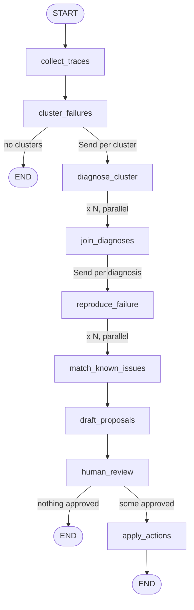

# TraceScan

A multi-agent system that acts as an on-call engineer for an LLM application. It reads the app's traces, groups the failures, diagnoses why each group happened, states how far each diagnosis has been verified, and drafts a GitHub issue plus a regression test for a human to approve.

Built as the AI Engineering capstone. The first target app is **Medas**, a clinician-facing RAG assistant.

> **Status: planning stage.** The repo holds the plan, a LangGraph sketch with stubbed nodes, a minimal FastAPI app and the Next.js starter. The collector, trace store, real nodes and eval do not exist yet. `PLAN.md` is the source of truth for scope and task order.

## The problem

Observability tools show what happened in each run, but someone still has to scroll through hundreds of failed traces to find the pattern. TraceScan turns that into a short report, for example: "38 failures this week fall into 3 groups; group A is the retriever returning nothing for drug-interaction questions; here are the cited spans, a draft issue and a test case."

## Scope

TraceScan runs a fixed triage pipeline, not an open chat: collect failures, cluster them, diagnose each cluster, check against known issues, then propose actions that a human approves.

What sets it apart from chat-with-your-traces tools:

- **Batch triage**: works across all failures in a time window and groups them.
- **Taxonomy-based diagnosis**: each cluster gets one category from a fixed list, with the trace spans cited as evidence.
- **Verification status**: every proposal says how far it was checked. In the MVP all diagnoses are `unverified`; nothing is dropped because it did not reproduce.
- **Memory of known issues**: repeat failures update an existing issue instead of creating a duplicate.
- **Closing the loop**: every approved issue comes with a regression case for the eval dataset.
- **Own tracing stack**: no third-party observability platform. Medas is instrumented with OpenTelemetry (`gen_ai.*` attributes) and sends traces to a FastAPI OTLP collector, which stores them in Postgres.

Failure categories: `retrieval_miss`, `tool_schema_error`, `context_overflow`, `prompt_regression`, `model_quality`, `infra_error`, the three top-level [MAST](https://arxiv.org/abs/2503.13657) categories (`system_design`, `inter_agent_misalignment`, `task_verification`), and `unknown`.

### MVP (due day 10 of 16)

- Medas traced into the own trace store, plus a traffic generator
- Minimal collector, Postgres store, heuristic scoring and a read-only MCP server
- Clustering (embeddings + HDBSCAN), diagnoser with structured output, human review gate
- Dry-run actions: issues written to `out/issues/<cluster>.md`, regression cases to a local JSONL file
- Fault-injection eval with six seeded Medas faults and healthy controls
- Minimal trace viewer in Next.js

### Stretch

Replay-based reproducer, known-issues memory with semantic matching, real GitHub issue creation, MAST-Data agreement study, review dashboard, LLM-judge scoring.

### Out of scope

Any change made without human approval, and automatically fixing the bugs found (TraceScan files issues, it does not patch code).

## The LangGraph graph

One `StateGraph` with nine nodes, two parallel fan-outs (via `Send`) and one pause for human approval.



| Node | What it does | Touches the outside world? |
| --- | --- | --- |
| `collect_traces` | Pulls failed or low-score traces for the time window through the read-only MCP server | Read |
| `cluster_failures` | Groups failures with embeddings + HDBSCAN. Code only, no LLM calls | No |
| `diagnose_cluster` ×N | One agent per cluster (LangChain `create_agent`, `response_format=Diagnosis`, recursion limit ~12) that can inspect span trees through read-only tools | Read |
| `join_diagnoses` | No-op barrier that waits for every diagnosis | No |
| `reproduce_failure` ×N | Stretch: replays exemplar inputs in a sandbox. In the MVP it only marks the diagnosis `unverified` | Execute (stretch) |
| `match_known_issues` | Links clusters to issues from earlier runs via the long-term store | Read |
| `draft_proposals` | Builds a create-or-update issue proposal and a regression case per cluster | No |
| `human_review` | `interrupt()` with the proposals; resumes with approve or reject per cluster | No |
| `apply_actions` | Writes approved proposals only: GitHub, eval dataset, known-issues store. `dry_run` defaults to `True` | Write |

### State

One shared `TriageState` flows through the graph. Fields filled by parallel branches (`diagnoses`, `reproductions`, `actions_log`) use an append reducer (`Annotated[list[...], operator.add]`), so results merge instead of overwriting. Parallel branches get small private inputs (`ClusterTask`, `ReproTask`), not the whole state, which keeps prompts short.

Key models, all Pydantic: `TraceSummary`, `Cluster`, `Diagnosis` (category, root cause, suggested fix, confidence, cited `Evidence`), `Reproduction`, `IssueProposal`.

### Memory

| Kind | Component | Scope | Holds |
| --- | --- | --- | --- |
| Short-term | Checkpointer (`InMemorySaver`, later `PostgresSaver`) | One run, keyed by `thread_id` | Graph state at every step, so a run can pause at review and resume later |
| Long-term | Store (`InMemoryStore`, later `PostgresStore`) | All runs, namespaced by target app | Known issues: cluster signature → issue id |

The store is written only after an approved action, so rejected proposals never become "known".

### Safety invariants

- Trace access is read-only. The MCP server (`search_failed_traces`, `get_trace_tree`, `get_span`) connects with a read-only Postgres role; the agent never touches the database directly.
- All writes happen only in `apply_actions`, only for human-approved proposals.
- `dry_run` is on by default. A dry run writes local files and nothing else.
- Every diagnosis must cite real trace ids and spans from its cluster.
- Medas traces may contain clinical content; raw span attributes must be checked for personal data before they reach issues, fixtures or logs.

### Sketch vs. target

`backend/tracedoctor_graph.py` is the starting point and runs end to end with fake data. It differs from the target design in a few places:

- Nodes are stubs; `diagnose_cluster` is a plain function, not yet an agent.
- It still mentions Langfuse in comments (stale: the project builds its own tracing stack).
- `draft_proposals` skips clusters that did not reproduce. The MVP rule is the opposite: keep every cluster and mark it `unverified`.

## Evaluation

Faults are injected into Medas one at a time, each triggered by several input sets, with healthy runs as controls (TraceScan should propose nothing there):

1. Retriever returns zero chunks for one question category
2. A tool's input schema no longer matches what the model sends
3. System prompt truncated so a key instruction is lost
4. Context window too small for long documents
5. Model swapped for a weaker one
6. Upstream API timeout on a share of calls

Diagnoses are graded on the injected cause, not just the visible symptom. Metrics: detection rate, root-cause accuracy, false positives, duplicate rate on a second run, false alarms on healthy runs, and cost and time per run.

## Repository layout

| Path | What it is |
| --- | --- |
| `PLAN.md` | Scope, architecture, task order and "Done when" checks |
| `.claude/prds/` | PRD and the generated work-packages brief |
| `backend/` | Python (FastAPI + LangGraph); `main.py` is the future trace collector, `tracedoctor_graph.py` the graph sketch |
| `frontend/` | Next.js 16 app: the future trace viewer and review UI |
| `tools/board/`, `tracescan-board.html` | Kanban board generator and its output |
| `CLAUDE.md` | Working rules and commands for Claude Code |

## Running it

Python is managed with [uv](https://docs.astral.sh/uv/); do not use `pip`.

```bash
cd backend && uv sync
```

Run the API (docs at `/docs`):

```bash
cd backend && uv run uvicorn main:app --reload
```

Run the graph sketch. It needs LangGraph 1.x, which is not a dependency yet:

```bash
cd backend && uv add langgraph && uv run python tracedoctor_graph.py
```

It runs to the review pause, prints the proposals, then resumes with decisions on the same `thread_id`.

Run the frontend:

```bash
cd frontend && npm install && npm run dev
```
