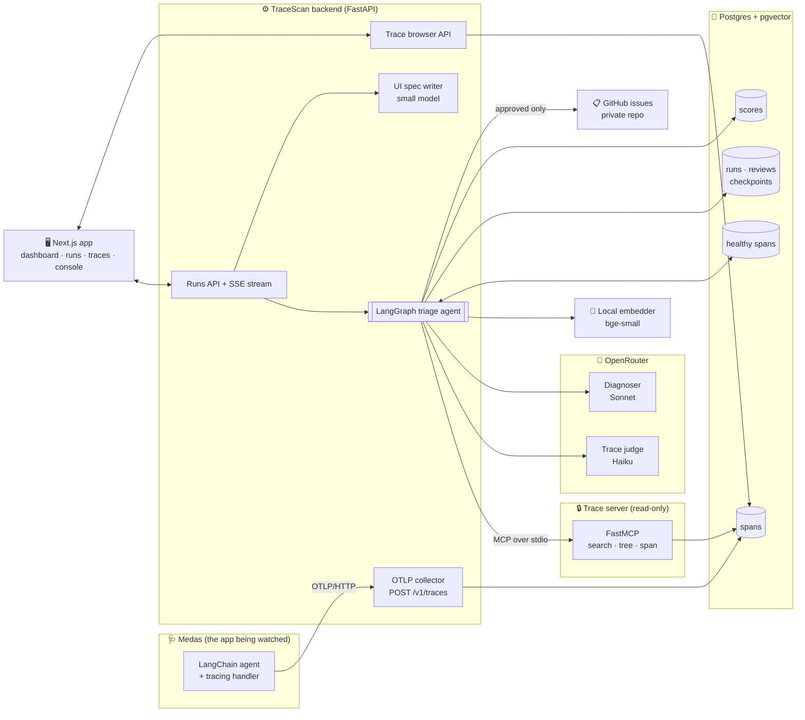
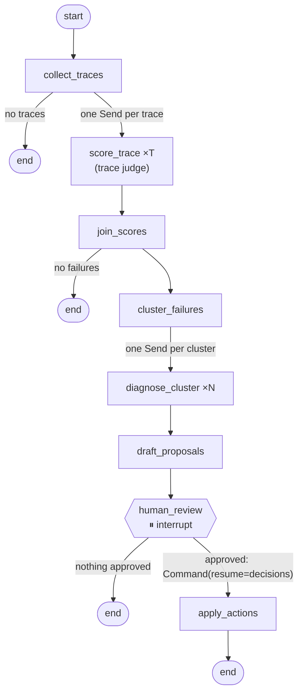
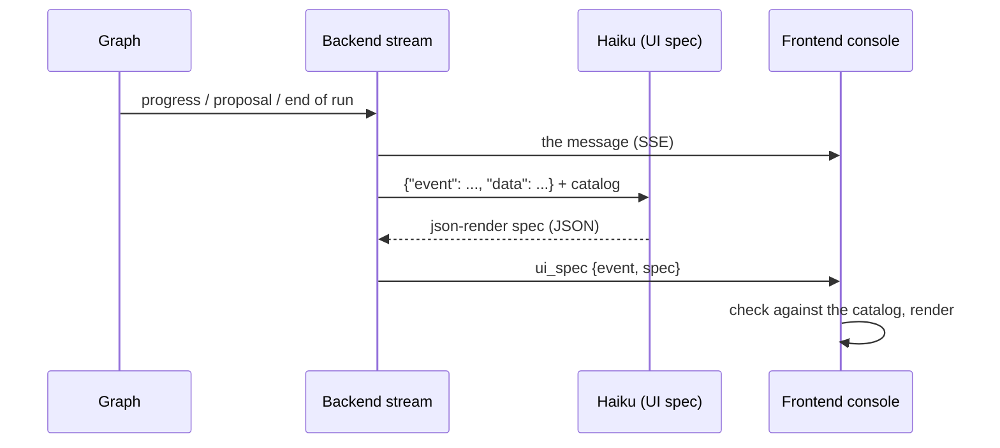

# TraceScan

**TraceScan finds out why an LLM application fails, and writes it up for a person to approve.**

LLM apps fail in many quiet ways: a tool times out, a search finds nothing and the model answers anyway, a prompt overflows the context, a provider returns a 503. Each failure leaves a trace, but nobody reads hundreds of traces a day. The errors that matter are mixed in with errors that don't (a retried rate limit, an expected "not found"), and a single bug shows up as forty separate failures.

TraceScan reads an app's traces and decides which requests actually failed their user. It groups those failures by cause, diagnoses each group with cited evidence, and drafts a GitHub issue plus a regression case for each one. Nothing is filed until a person approves it.

The first app it watches is **Medas**, a clinician-facing RAG assistant. Medas traces can touch clinical data, so TraceScan reads traces without copying their content around. Names, statuses, error types and counts travel through the pipeline; prompts, answers and patient records never do.

---

## Contents

1. [Traces and spans](#traces-and-spans)
2. [From traces to diagnoses](#from-traces-to-diagnoses)
3. [The APIs](#the-apis)
4. [The system](#the-system)
5. [The agent](#the-agent)
6. [The evaluation](#the-evaluation)
7. [The json-render console](#the-json-render-console)
8. [Running it](#running-it)

---

## Traces and spans

A **span** is one timed step of work, such as a model call, a tool call or a database search. It has a name, a start and an end, a status (`ok`, `error` or `unset`), and attributes (which model, which tool, how many results).

A **trace** is all the spans of one request, linked into a tree through their parent ids. The root span is the whole request, and its children are the steps it took.

Medas names its spans after the [OpenTelemetry GenAI conventions](https://opentelemetry.io/docs/specs/semconv/gen-ai/):

| Span name | What it is |
| --- | --- |
| `invoke_agent medas` | The whole request (the root) |
| `chat <model>` | One call to the language model |
| `execute_tool <tool>` | One tool call, such as a PubMed search |
| `retrieval record_chunks` | A search of the patient record, with its hit count in `retrieval.hits` |

### An example

A clinician asks a question. The model decides to search PubMed, PubMed doesn't answer in time, and the model answers without it:

```text
invoke_agent medas                         ok      12.6 s
├── chat openai/gpt-4.1-mini               ok       1.1 s
├── execute_tool search_pubmed             error   10.2 s   httpx.ReadTimeout
└── chat openai/gpt-4.1-mini               ok       1.3 s
```

Here is the failing span as it is stored:

```json
{
  "trace_id": "4bf92f3577b34da6a3ce929d0e0e4736",
  "span_id": "00f067aa0ba902b7",
  "parent_span_id": "a3ce929d0e0e4736",
  "name": "execute_tool search_pubmed",
  "start_time": "2026-01-15T09:12:03.104Z",
  "end_time": "2026-01-15T09:12:13.304Z",
  "status": "error",
  "status_message": "search_pubmed timed out after 10.2s",
  "attributes": {
    "gen_ai.operation.name": "execute_tool",
    "gen_ai.tool.name": "search_pubmed",
    "error.type": "httpx.ReadTimeout"
  }
}
```

Look at the root's status: `ok`. As far as the status goes, the request succeeded, yet the clinician got an answer with no literature behind it. Status codes alone can't tell that this request failed, which is why TraceScan uses a judge.

---

## From traces to diagnoses

### 1. Gathered

Medas is instrumented in its own repo. A LangChain callback handler builds one trace per agent run and sends it over **OTLP/HTTP** to TraceScan's collector (`POST /v1/traces`). Each export carries the app's own collector token (`Authorization: Bearer …`, from `COLLECTOR_TOKEN_MEDAS`); the collector refuses one without it, keeps only the spans of the app the token belongs to, drops spans that start in the future, cuts over-long names and status messages, strips what Postgres cannot store (NUL characters, NaN), refuses an export over 4 MiB or 2,000 spans, decodes the protobuf and writes one row per span to Postgres (`spans`). A span that is already stored is skipped, so an exporter's retry changes nothing. There is no `traces` table: a trace is just the spans that share a `trace_id`.

For development and the eval, `scripts/seed_traces.py` writes realistic synthetic Medas traffic through the same decoder.

### 2. Sampled

A run covers one app over one time window. `collect_traces` takes **every trace in the window, newest first, up to 200** (`MAX_JUDGED_TRACES`). Later, each cluster sends only its **3 newest traces** (`MAX_EXEMPLARS`) to the diagnoser, so the expensive model sees a sample of each cluster, not all of it.

> **Note: a run judges at most the 200 newest traces in its window.** The trace judge makes one model call per trace, so `MAX_JUDGED_TRACES` (200, also the trace server's cap on one search) bounds what a run costs and how long it takes. In a busier window, the traces older than the newest 200 are **not judged at all**, so a fault that only happened earlier in the window is not found. The New run form says so, and a run that reached the limit says so on its page. To cover a busy period, run it as several shorter windows.

### 3. Scored and judged

Every collected trace goes to the **trace judge** (`anthropic/claude-haiku-5.5`, one call per trace, 16 at a time). It reads the span tree as JSON, with attribute values outside an allowlist replaced by `[redacted]`, and answers:

| Field | Meaning |
| --- | --- |
| `reason` | One or two sentences, naming spans only |
| `score` | From 0.0 (failed its user) to 1.0 (went fine). **0.5 or less counts as failed** |
| `blamed_span_id` | Where the failure started; if several steps failed, the one that ended the request |
| `attribution` | `app`, `external` or `unclear` |
| `healthy_span_ids` | For a clean trace, up to 3 steps that worked (see below) |

The prompt holds the hard lessons from the eval:

- A model that answers after a failed tool call has not recovered.
- A lookup that says "not found", told to the user, is the app working as designed.
- A search with 0 hits is a failure even when no span has an error.
- An unsure judge scores 0.6, never 0.5, so doubt doesn't count as failure.

If the judge blames a span that isn't in the tree, it is asked once more. If it still gets it wrong, the code blames the deepest error span instead. The verdicts are saved to `scores` so the trace browser can show them.

**Healthy picks.** A trace scored 0.9 or more, with no error and no empty search, may name up to 3 spans that worked. They go into a **healthy-span store** (pgvector), so the diagnoser can later compare a failing step with the same step working.

### 4. Embedded

Each failed trace is reduced to one short **failure text**: the failing step, the error message and a signature. Digits are masked, so `timed out after 10.2s` and `timed out after 10.4s` read the same. Seconds are turned into a word first (`slow (2-5 s)`, `very slow (>5 s)`), so a 1 s timeout and a 10 s timeout still read differently:

```text
execute_tool search_pubmed: search_pubmed timed out after very slow (>5 s) | ...
```

That text is embedded **on the machine** with `BAAI/bge-small-en-v1.5` (fastembed, ONNX, 384 dimensions). Trace content is never sent out to be embedded.

### 5. Clustered

Clustering is plain code, with no LLM calls. It has two stages:

1. **HDBSCAN** (cosine distance, `min_cluster_size` 3, `min_samples` 4) finds the dense groups. A trace that HDBSCAN attaches with a membership under 0.1 is treated as noise, so a lone outlier isn't swallowed by its nearest group.
2. The noise is **regrouped by failing step and error type**. A group of 2 or more becomes a `step_error` cluster: the same step failing with the same error is one issue, however few times it happened. Anything left becomes an `isolated` one-trace cluster, so a rare failure still gets diagnosed.

A run with fewer than 6 failures skips HDBSCAN and goes straight to the second stage. The embeddings are also projected to 3D for the cluster map on the run page: PCA, or t-SNE from 30 points up, whichever better keeps each point's neighbours.

### 6. Diagnosed

The diagnoser (`anthropic/claude-sonnet-5-5`) makes one structured-output call per cluster, at most 4 at once. Its system prompt is the failure taxonomy. It is shown the exemplar span trees and, when there are any, up to 3 **healthy twins**: calls of the same step, on the same app version and telemetry schema, that worked. It answers:

```json
{
  "category": "infra_error",
  "root_cause": "search_pubmed has a 10 s timeout and PubMed regularly exceeds it; the tool reports the timeout to the model, which answers without sources.",
  "suggested_fix": "Retry once with backoff, and tell the user when literature search is unavailable.",
  "confidence": 0.82,
  "evidence": [{ "trace_id": "4bf9…", "span_id": "00f0…", "note": "ReadTimeout after 10.2 s" }]
}
```

The categories are `retrieval_miss`, `tool_schema_error`, `context_overflow`, `prompt_regression`, `model_quality`, `infra_error`, the MAST groups `system_design`, `inter_agent_misalignment` and `task_verification`, and `unknown`.

**The code checks the evidence.** Every cited span must be in the trees the model was shown. If one isn't, the model is asked once more, with the valid ids listed. If it still cites spans it never saw, those citations are dropped, the confidence is capped at 0.3, and the diagnosis is flagged `unsupported`. Each cluster has a budget of 3 calls, 100k tokens and $0.50, and transient errors are retried with backoff within it.

### 7. Drafted, reviewed, applied

Each cluster becomes a **proposal**: an issue title and body, and a regression case made of ids only (the exemplar traces and the cited spans, no span text). Then the graph **pauses** for review. A reviewer approves or rejects each proposal, and only approved ones are written:

- **Dry run** (the default): `out/issues/<cluster>.md` and `out/regression_cases.jsonl`.
- **Live** (`DRY_RUN=0`): one GitHub issue per proposal in a **private** repo (the app refuses a public one), plus the regression cases.

---

## The APIs

Every route needs a Clerk session token (`Authorization: Bearer …`) except `/health` and the collector, which takes an app's collector token instead.

### Runs

| Method | Path | What it does |
| --- | --- | --- |
| `POST` | `/v1/runs/stream` | Starts a run (`target_app`, optional `since`/`until`) and streams it as server-sent events. 10 runs per user per hour |
| `GET` | `/v1/runs` | One page of runs, newest first (`limit`, `offset`), with the total in `X-Total-Count` |
| `GET` | `/v1/runs/{id}` | The status (`in_progress`, `review_required`, `completed`, `failed`, `aborted`), the counts and the proposals |
| `GET` | `/v1/runs/{id}/detail` | Per cluster: signature, traces, diagnosis, spend and decision; plus the 3D cluster map |
| `POST` | `/v1/runs/{id}/review` | `{"decisions": {"c0": "approve", "c1": "reject"}}` resumes the paused run. `409` if it isn't waiting, `422` if the decisions don't match the proposals |
| `POST` | `/v1/runs/{id}/resume/stream` | Goes on with a run that failed or was aborted, from its last checkpoint: only what had not finished runs again, streamed like a new run. `409` when it cannot be resumed; counts against the same run limit |

The stream sends, in order: `run_started`, the `progress` events, one `proposal` per drafted issue, then `review_required` or `run_completed` (or `run_failed`). Each message except `run_failed` is followed by a `ui_spec` (see [the console](#the-json-render-console)).

### Traces

| Method | Path | What it does |
| --- | --- | --- |
| `POST` | `/v1/traces` | The OTLP collector: binary protobuf in, rows in `spans`. Needs the app's collector token (`COLLECTOR_TOKEN_MEDAS`); 413 over 4 MiB or 2,000 spans |
| `GET` | `/v1/traces` | One page of traces with their verdicts (`app`, `since`, `until`, `failed_only`, `limit`, `offset`) |
| `GET` | `/v1/traces/{id}` | One trace's span tree (attributes outside the allowlist read `[redacted]`) and its scores |
| `GET` | `/health` | Liveness |

### MCP (for the agent only)

The graph never touches the database. It reads traces through a **read-only FastMCP server** over stdio, one server process per run:

| Tool | What it returns |
| --- | --- |
| `search_traces` | The trace summaries of one app in a window |
| `get_trace_tree` | One trace as a sanitized span tree |
| `get_span` | One span |

Ids are checked against a pattern and apps against an allowlist. A guard caps each run at 500 tool calls and logs every call with a hash of its arguments, never the arguments themselves.

---

## The system



| Component | Role | What it does |
| --- | --- | --- |
| **Medas** | The app being watched | Sends one OpenTelemetry trace per agent run, with no prompt, answer or record text |
| **Collector** (`api/traces.py`) | Intake | Decodes OTLP protobuf, filters by app, stores each span once |
| **Postgres** | Memory | `spans` and `scores` for traces; `runs`, `reviews` and the LangGraph checkpoints for runs; pgvector for healthy spans. The schema is managed with Alembic |
| **Trace server** (`trace_store/`) | The agent's only view of traces | Read-only MCP tools, sanitized output, a call budget per run, an audit log |
| **Triage agent** (`agent/`) | The brain | The LangGraph pipeline: judge, cluster, diagnose, draft, wait, apply |
| **Runs module** (`runs/`) | A run's lifecycle | Starts runs, streams progress, reads status from the checkpoints, and locks a run during review so two reviewers can't apply it twice |
| **Local embedder** | Similarity | Embeds failure texts and healthy steps on the machine |
| **OpenRouter models** | Judgement | Haiku judges traces and writes the console's UI; Sonnet diagnoses clusters; the eval's grader is from another vendor |
| **Auth** (`auth/`) | Identity | Verifies Clerk session tokens; who starts or reviews a run comes only from the token |
| **Frontend** (`frontend/`) | The reviewer's desk | Dashboard, runs, a run page with the pipeline stepper, 3D cluster map and findings, the trace browser, and the agent console |
| **GitHub** | Output | Issues for approved proposals only, in one private repo |

---

## The agent

The agent is one LangGraph `StateGraph`. Parallel work fans out with `Send`, and the run pauses for review with `interrupt()`.



### The nodes

| Node | Model | Reads | Writes |
| --- | --- | --- | --- |
| `collect_traces` | none | The window, through the MCP tool `search_traces` | `traces` |
| `score_trace` ×T | Haiku | One trace tree | A verdict, healthy picks, usage |
| `join_scores` | none | All the verdicts | `failed_traces`, each labelled with its blamed step and error type |
| `cluster_failures` | none (local embeddings) | The failed traces | `clusters` and the 3D `cluster_map` |
| `diagnose_cluster` ×N | Sonnet | One `ClusterTask`: the cluster, its exemplar trees, its healthy twins | A diagnosis or a recorded failure, usage |
| `draft_proposals` | none | Clusters and diagnoses | One `Proposal` per cluster; an undiagnosed cluster gets a stub, never dropped |
| `human_review` | none | The proposal ids | Pauses; resumes with one decision per proposal |
| `apply_actions` | none | The approved proposals | Issue files or GitHub issues, and regression cases. The **only** node that writes |

### How a run flows

1. **Start.** The frontend calls `POST /v1/runs/stream`. The runs module opens a trace server session, starts the graph on a new thread with a Postgres checkpointer, and streams the progress.
2. **Fan out, fan in.** Judge branches run 16 at a time and report progress every quarter. Diagnose branches are held to 4 at a time by a semaphore. Their outputs are merged into lists with append reducers.
3. **Pause.** At `human_review` the state is checkpointed and the stream ends with `review_required`. From here the run survives a restart.
4. **Review.** The reviewer approves or rejects each finding in the web app. `POST /review` locks the run's row, resumes the graph without opening a trace session, and commits the decisions and the new status in one transaction.
5. **Apply.** The approved proposals are written, and the actions log comes back in the response.

### Guardrails

- **Read-only traces.** The agent imports no database driver, and a test enforces it.
- **Budgets everywhere.** Per trace, per cluster, and per run for tool calls. Only transient errors are retried.
- **Evidence or nothing.** Diagnoses cite real spans, and the code checks them.
- **People approve every write.** A rejected proposal never reaches GitHub.
- **Dry run by default.** Only the server sets it, never a request.
- **No clinical text in logs.** Errors are logged by exception type only.

---

## The evaluation

### How it works

Triage can't be measured on real traffic without knowing the right answers. So the eval **seeds a day of synthetic Medas traces with known faults** and scores what the pipeline finds against an answer key. The kind of each trace is worked out again from the day's date and never stored, so the agent can't read the answer.

| Kind | Traces | Examples |
| --- | --- | --- |
| Plain faults | 22 | PubMed timeout (6), bad tool arguments (5), provider down (5, two faces: a 5xx or a timeout), context overflow (5), record store down (1, the rare one) |
| Hard cases | 12 | A look-alike timeout set too tight (3), two errors where the first isn't the cause (2), a failure at the root span only (3), a search that silently finds nothing (4) |
| Not faults | 18 | Healthy requests (12), a retried rate limit (3), an expected not-found (3) |

A **control day** (`--control`) seeds 52 harmless traces only, so anything found there is a false alarm.

A grader from another vendor (`openai/gpt-6.1-sol`) scores each root cause from 0 to 2 against the **injected cause**, not the visible symptom.

| Metric | The question it answers |
| --- | --- |
| Judge recall / false positives | Did the judge catch every faulty trace and leave the harmless ones alone? |
| Judge blame | Did it blame the step the answer key names? |
| Detection | How many faults got a diagnosis of their own? |
| Purity | How many traces sit in a cluster of their own fault? |
| Separation | How many faults are alone in exactly one cluster? |
| Rare recall | Was the one-off fault found? |
| Category / cause accuracy | Did the diagnosis get the category and the real cause right? |

```bash
cd backend
uv run --env-file .env python -m eval.run        # seed a day and triage it: out/eval/<time>.json
uv run --env-file .env python -m eval.judge      # grade the root causes
uv run python -m eval.metrics                    # print the scores
```

### On Medas's own faults

The seeded day is synthetic: its traces were written to look like Medas's. This experiment asks the same question of **Medas itself**. When a real bug is switched on in the real agent, among healthy requests, does TraceScan find it, keep it apart from the others, and name its cause?

#### Setup

**The faults.** Medas has six known bugs, each switched on by one environment variable (`FAULT_*`, `medas-api/faults.py` in [Nelev/medas](https://github.com/Nelev/medas)). Medas's spans carry no question, answer or record text. For TraceScan to see faults that raise no error, Medas also sends two safe signals:
- the reply's shape on the root span (`medas.reply.format`)
- a failed lookup's own reason (`source timed out`, `source unavailable`)

| Fault | What breaks | What the trace shows | The cause a diagnosis must name |
| --- | --- | --- | --- |
| Empty retrieval | The record search drops every passage for medication searches | A search with 0 hits, no error | A filter that empties one category |
| Broken tool schema | The record search is called with a renamed argument | A validation error on every call | The argument no longer matches the schema |
| Truncated prompt | The system prompt is cut before its Output section | A malformed reply, no error | The prompt lost its output format |
| Small context | The model is sent too few tokens to keep a search result | The same search round after round, no error | The context budget is too small |
| Weak model | The agent runs on another model, which skips its tools | One model call and nothing else | The model was swapped |
| Upstream timeout | Half the health-source calls time out | A lookup with `source timed out` | The health sources time out |

**The traffic.** The answer key is `backend/eval/medas_ground_truth.py`. It gives each fault two or three sets of real questions from Medas's traffic file, varied by question, spelling and language. One window holds:
- every fault's sets, each sent with only that switch on
- every normal and edge question with no switch on, as controls

That's 56 requests in 17 sends. A trace counts as a fault only if the fault actually fired on it, as read off its stored spans by the grader, never by the agent. For example, a timeout share can spare a request, and a search not about medication never hits the empty retrieval. That left 24 faulty requests and 32 healthy ones.

**The method.** The traffic was sent once, on 2026-11-14. Each change to TraceScan was then measured with `--retriage`, which triages the same stored window again. Every column below is therefore the same 56 requests, and only TraceScan changed between them. After each change, the seeded day and the control day were run again to check nothing regressed. A grader from another vendor (`openai/gpt-6.1-sol`) scores each diagnosis from 0 to 2 against the injected cause.

```bash
cd backend
uv run --env-file .env python -m eval.medas_run   # send every fault and the controls, triage the window
uv run --env-file .env python -m eval.judge       # grade the root causes
uv run python -m eval.metrics                     # print the scores
uv run --env-file .env python -m eval.medas_run --retriage out/eval/<file>.json   # same traces, triaged again
```

It needs the backend running (Medas sends its traces to the collector), Medas's database up, and the Medas checkout next to this one (`--medas` for another place). `--only tool_schema,weak_model` sends just those faults; `--control` sends the healthy traffic alone.

#### Results

The first run found what raised an error and missed what didn't. Four changes followed, each aimed at what the run before had shown:

1. **First run:** the judge as it was.
2. **Loop rule:** the judge fails a request that asks for the same step in four rounds or more, although every call succeeded.
3. **Silent-failure symptoms:** a failure with no error gets fixed words for what the trace shows (a search that found nothing, a tool asked for round after round, a reply not in the asked-for shape). Clustering now tells these failures apart instead of grouping them all under the step they failed at.
4. **One failed step:** the judge is told that one failed lookup fails the request even when the others worked.
5. **Pairs:** two failures with the same step and error make one cluster, not two.

| Score | 1. First run | 2. Loop rule | 3. Symptoms | 4. One failed step | 5. Pairs |
| --- | --- | --- | --- | --- | --- |
| Faulty requests the judge caught | 15/24 | 16/24 | 15/24 | 18/24 | **18/24** |
| Healthy requests flagged | 0/32 | 0/32 | 0/32 | 0/32 | **0/32** |
| Detection (faults with a finding) | 4/6 | 4/6 | 4/6 | 5/6 | **5/6** |
| Purity | 15/15 | 13/16 | 15/15 | 18/18 | **18/18** |
| Separation (one fault, one cluster) | 3/6 | 1/6 | 3/6 | 4/6 | **5/6** |
| Category accuracy | 4/5 | 5/6 | 2/4 | 4/6 | 3/5 |
| Cause accuracy (graded 2 of 2) | 2/5 | 1/6 | 0/4 | 2/6 | 2/5 |
| False alarms | 0 | 0 | 0 | 0 | 0 |
| Cost (judge and diagnoser) | $0.12 | $0.18 | $0.16 | $0.19 | $0.18 |

The same changes left the seeded day and the control day unchanged:

| Day | Result |
| --- | --- |
| Seeded day | detection 8/8, purity 34/34, separation 7/8, judge 34/34 with no false positives |
| Control day | 0 of 52 requests flagged |

Where each fault ends up after the last change (`out/eval/20261114T074518Z.json`):

| Fault | Judge caught | Finding | Diagnosis | Cause graded |
| --- | --- | --- | --- | --- |
| Broken tool schema | 5/5 | one cluster | `tool_schema_error`: the arguments don't match the schema | 2 |
| Upstream timeout | 2/2 | one cluster | `infra_error`: MedlinePlus timed out | 2 |
| Small context | 3/3 | one cluster | `system_design`: the agent keeps searching | 1 |
| Empty retrieval | 3/3 | one cluster | `retrieval_miss`: the record search returned nothing | 1 |
| Truncated prompt | 5/5 | one cluster | `unknown`: the replies are malformed, cause not shown | 0 |
| Weak model | 0/6 | none | | |

#### Findings

1. **Finding faults on a real app takes more than spotting errors.** The judge first passed every request that failed without an error. Two rules got it to catch everything but the weak model: a step asked for round after round, and one failed lookup among several. Neither flagged a healthy request on Medas, the seeded day or the control day.
2. **Silent failures need their own words to cluster.** A failure with no error used to be grouped only by the step it failed at, so two different faults blamed on a model call shared one cluster. Fixed words for what the trace shows give each its own, in code and with no model call.
3. **Two of a kind is one issue.** Two identical failures used to become two findings, so a reviewer would get two proposals for one bug.
4. **TraceScan finds where a fault broke more often than why.** Only the schema and timeout diagnoses name their cause, because only their spans say what happened (a validation error, `source timed out`). Medas's spans say a reply was malformed or a search found nothing, but not why. Better causes need more safe signals from Medas, such as the refused argument's name or the size of what the model was sent. Rewording TraceScan's prompts won't produce them.
5. **The weak model is invisible on the trace.** One model call and no tool is also what a healthy answer to a blank question looks like. Only the model's name differs, and TraceScan doesn't know which model Medas is meant to use.

**Limits.**
- **One traffic sample:** every column triages the same 56 requests, so the numbers show what each change does to those requests, not how they'd vary over new traffic.
- **The models vary:** category and cause accuracy move between runs even when nothing changes. On the seeded day the same diagnosis was graded 2 one time and 1 the next.
- **Next:** repeated runs over fresh traffic to put numbers on that variance, Medas signals that say why, and the weak model.

The full log of each step is in [`docs/eval-notes.md`](docs/eval-notes.md).

### How it started, and what changed

| # | Change | What it showed |
| --- | --- | --- |
| 1 | First run: plain faults, then the hard cases | Plain faults scored 5/5 everywhere, which proved nothing. With the hard cases, one 17-trace cluster swallowed five kinds, and failures with no error were never collected (trace recall 30/34) |
| 2 | A heuristic scoring job (five checks in code) | It collected all 34 faulty traces and left out the harmless ones, but the clustering still grouped by *step*, not by *cause*, and the rare fault was absorbed |
| 3 | An **LLM trace judge** replaces the heuristics | It never flagged a harmless trace, but missed 10 faults: its prompt counted "the model answered afterwards" as recovery |
| 4 | Judge prompt: a stricter recovery rule, and "judge only what the trace shows" | 34/34 recall and no false positives. Clustering became the bottleneck |
| 5 | A fresh day and a control day | The judge held on a day it had never seen. One control trace landed exactly on 0.5 ("unsure"), which counted as failed |
| 6 | Looking into the clustering (no code change) | The look-alike timeouts had *identical* failure texts, because masking the digits erased the only difference. HDBSCAN attached lone outliers with a membership of 0.0 |
| 7 | Judge rules: unsure is 0.6, "not found" is fine, blame the failure that ended the request | Right blame went from 32/34 to 34/34, control false alarms to 0. It also showed that the answer key penalized a correct merge |
| 8 | Seconds as words, a membership threshold of 0.1, faults that share a cause count as one | Every cluster now holds one fault |

### The gains

From the first run with the hard cases (experiment 1) to the latest (experiment 8):

| Score | Exp 1 | Exp 3 (judge) | Exp 5 (fresh day) | **Exp 8** |
| --- | --- | --- | --- | --- |
| Faulty traces collected | 30/34 | 24/34 | 34/34 | **34/34** |
| Harmless traces flagged | 6, absorbed into a real cluster | 0/14 | 0/18 | **0/18** |
| Judge blames the right step | n/a | n/a | 32/34 | **34/34** |
| Detection | 6/9 | 7/9 | 6/9 | **8/8** |
| Purity | 24/36 | 22/24 | 27/34 | **34/34** |
| Separation | 3/9 | 3/9 | 2/9 | **7/8** |
| Rare-failure recall | 1/1 | 1/1 | 0/1 | **1/1** |
| Cause accuracy (graded 2 of 2) | 6/6 | 10/10 | 5/6 | **9/9** |
| False alarms on the control day | n/a | n/a | 1 | **0** |
| Cost per run | $0.10 | $0.16 | $0.13 | **$0.17** |

Experiment 8 counts 8 faults, not 9: the two-error requests have the same cause as the provider outage, so grouping them is the right answer. The one miss left is a *split*: the provider outage's two faces (5xx and timeout) land in two clusters that both name the same cause.

**Limits.** One run per day, on synthetic traffic, partly on days the fixes were written for. Next come a third unseen day, repeated runs to average out the models' variance, and real Medas traffic. The full log is in [`docs/eval-notes.md`](docs/eval-notes.md), and the review write-up in [`docs/eval/review.md`](docs/eval/review.md).

---

## The json-render console

While a run streams, the web app shows an **agent console**: a chat box in the corner that tells the run as it happens, in plain language. Its messages aren't hand-built components: for each streamed message, a small model writes the UI.



**How it works**

1. Each message (`progress`, `proposal`, `run_completed`, …) goes to the browser first, so the UI call never holds it back.
2. The backend then asks `anthropic/claude-haiku-5.5` for a **[json-render](https://github.com/vercel-labs/json-render) spec**: a flat tree of elements (`Stack`, `Card`, `Badge`, `Alert`, `Table`, `Collapsible`, …) with literal props only, no expressions and no actions.
3. The prompt carries the **component catalog in words**, generated from the frontend's own catalog (`npm run export:ui-prompt` writes `backend/api/ui_catalog.md`, and a test fails when it is out of date), so the model knows every component, prop and allowed value.
4. The backend doesn't check the spec: it parses the JSON and passes it on. The **frontend checks** each element against its component's zod schema and draws it with the design system's components. An invalid spec shows one line and logs why (paths and codes, never values).

For example, a `progress` message becomes a badge and a line of text. A `proposal` becomes its title, badges for the cluster and its verification, a warning for an unverified cause, a table of trace and span ids, and the issue text in a collapsible.

**Limits that keep it safe and cheap.** At most 40 UI calls per run, 15 s each. A message whose call fails or is too slow has no spec and isn't drawn. **Raw events** in the console shows the stream exactly as received, for when you want the facts without the layout.

---

## Running it

**Requirements:** Python with [uv](https://docs.astral.sh/uv/), Node and npm, and Docker.

```bash
docker compose up -d
```

```bash
cd backend && uv sync && uv run --env-file .env alembic upgrade head
```

```bash
cd backend && uv run --env-file .env uvicorn main:app --reload
```

```bash
cd frontend && npm install && npm run dev
```

`backend/.env` needs `DATABASE_URL`, `TRACE_DATABASE_URL`, `OPENROUTER_API_KEY` and `CLERK_SECRET_KEY`, and `frontend/.env.local` needs the Clerk keys (see the `.env.example` files). Optionally, `DRY_RUN=0` with `GITHUB_REPO` and `GITHUB_TOKEN` opens real issues, and `TRACE_JUDGE_MODEL`, `DIAGNOSER_MODEL` and `UI_SPEC_MODEL` swap the models.

No Medas? Seed a day of synthetic traffic:

```bash
cd backend && uv run --env-file .env python -m scripts.seed_traces
```

To run next to Medas (which uses ports 8000 and 3000), use 8010 and 3010, point Medas's `OTEL_EXPORTER_OTLP_TRACES_ENDPOINT` at `http://localhost:8010/v1/traces`, and give Medas its token with `OTEL_EXPORTER_OTLP_TRACES_HEADERS=Authorization=Bearer%20<token>` (TraceScan's `COLLECTOR_TOKEN_MEDAS`).

**Checks:**

```bash
cd backend && uv run ruff check . && uv run ruff format --check . && uv run pyright -p .. && uv run pytest
```

```bash
cd frontend && npm run lint && npx tsc --noEmit && npm test
```

Tests never call a model. The Postgres tests run when `TEST_DATABASE_URL` is set.
