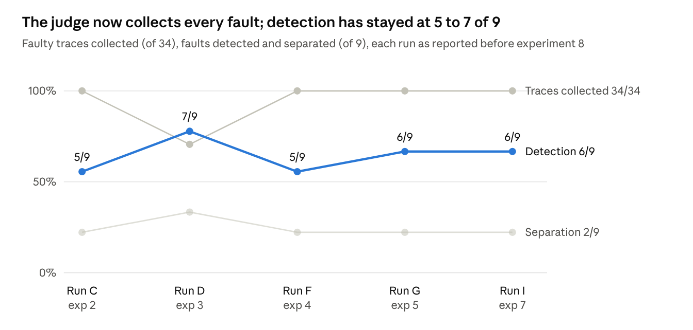

# TraceScan eval: experiments and results

2026-11-12 · Mattia

A copy of the review document, for the repository. The workbook beside it, [eval-results.xlsx](eval-results.xlsx), has every run's scores, the clusters, the answer key, the metric definitions and both rubrics. The full log of each experiment is [docs/eval-notes.md](../eval-notes.md).

## Summary

The trace judge is now reliable on seeded traffic; the clustering is the weak stage. On a fault day the judge was not tuned on, it catches 34/34 faulty traces, blames the right step in 34/34 and flags 0/18 harmless ones. On a day with no fault it flags 0/52, so nothing is proposed. Every diagnosed cluster names the injected cause (6/6), but only 6 of the 8 faults get a cluster of their own, and 2 of 8 a cluster holding nothing else.

The two faults lost are a look-alike timeout and the rare store outage. Both are clustering problems with a known mechanism (experiment 6). Reviewers are asked to check the method and the scoring changes, and to decide the open questions in the last section.

All numbers are one run per day on synthetic traces seeded into the trace store, not real Medas traffic.

## How the eval works

The eval runs the whole triage on one seeded day of traces whose answers are known, and scores what it found against an answer key. Commands: `python -m eval.run`, then `eval.judge`, then `eval.metrics`, from `backend/`.

**The day.** `scripts/seed_traces.py` writes 52 synthetic Medas traces into the trace store, spread over 24 hours. The traces are made with OpenTelemetry under the same span names Medas emits, and contain no patient text. The kind of each trace is worked out again from the day's date and never stored, so nothing the pipeline reads gives the answer away.

| Kind | Traces | What it is |
| --- | --- | --- |
| Plain faults | 22 | PubMed timeout (6), bad tool arguments (5), model provider down (5, two faces: 5xx or timeout), context overflow (5), record store down (1, the rare one) |
| Hard cases | 12 | a look-alike timeout set too tight (3), two errors where the first is not the cause (2), a failure only at the root span (3), a search that silently finds nothing (4) |
| Not faults | 18 | healthy requests (12), a rate limit retried successfully (3), an expected not-found (3) |

**The control day.** `eval.run --control` seeds 52 traces of the three harmless kinds only (36 healthy, 8 retried, 8 not-found), so anything it finds is a false alarm.

**The pipeline under test.** The trace judge (`claude-haiku-5.5`, one call per trace) decides which traces failed and blames a span. Clustering (local embeddings and HDBSCAN, no model) groups the failures. The diagnoser (`claude-sonnet-5-5`, one call per cluster) names a category and a root cause with cited spans. A grader from another vendor (`gpt-6.1-sol`) scores each root cause 0 to 2 against the injected cause, not the visible symptom.

**The scores.** Each cluster takes the fault most of its traces are of. Since experiment 8, seeded kinds that share an injected cause count as one fault, so a day has 8 faults.

| Score | Question it answers |
| --- | --- |
| Judge recall / false positives | Did the judge call the faulty traces failed, and the harmless ones fine? |
| Judge blame | Did it blame the step the fault starts in? |
| Detection | Did each fault get a cluster where it is the majority, and a diagnosis? |
| Purity | What share of clustered traces sit in a cluster of their own fault? |
| Separation | Did each fault land alone in exactly one cluster? |
| Rare-failure recall | Did the one-trace fault get its own diagnosis? |
| Category / cause accuracy | Is the category right, and does the root cause name the injected cause (grader score 2)? |
| Evidence valid / relevant | Do the cited spans exist in the cluster, and include the span the fault failed in? |
| False alarms | How many clusters hold a trace with no fault? |

## The experiments

Eight experiments over three days, each changing one thing and re-running on a seeded day. Newest first; each is logged in full in `docs/eval-notes.md`.

| # | Date | Question | What changed | Outcome |
| --- | --- | --- | --- | --- |
| 8 | 2026-11-12 | Is grouping two kinds with one cause a loss? | Answer key: `double_failure` shares the provider outage's cause; scores count by cause (8 faults) | Run I's purity 27/34 → 29/34; the provider merge now counts as right |
| 7 | 2026-11-12 | Can the judge stop landing on 0.5 and blame the error that ended the request? | Judge prompt: unsure scores 0.6, a not-found is by design, blame the last failure | Blame 32/34 → 34/34; control false alarms 1 → 0; recall stays 34/34 |
| 6 | 2026-11-12 | Why does clustering merge faults? | Analysis only: HDBSCAN re-run on run G's texts | Timeouts have identical texts; the lone store outage is absorbed with membership 0.0, which the code ignores |
| 5 | 2026-11-12 | Does the tuned judge hold on a new day, and on a day with no fault? | Judge scored in `eval.metrics`; control day added | Fresh day 34/34 caught, 0/18 flagged; control 1/52 flagged (scored exactly 0.5) |
| 4 | 2026-11-11 | Does a stricter recovery rule catch the faults the judge missed? | Judge prompt: a final answer is not recovery; judge only what the trace shows | Recall 24/34 → 34/34, 0/14 harmless flagged; detection 5/9, separation 2/9 |
| 3 | 2026-11-11 | Can an LLM trace judge replace the heuristic scoring? | Heuristic scoring replaced by one judge call per trace | Recall fell to 24/34: the judge read "the model answered" as recovery; nothing harmless flagged |
| 2 | 2026-11-10 | Do heuristic scores fix what the reader collects? | Five code checks per trace; an error span alone no longer means failed | All 34 faults collected, harmless errors left out; clusters form by failing step, not cause |
| 1 | 2026-11-10 | Does triage work at all on known faults? | First seeded runs: plain faults, then hard cases | Plain faults 5/5 everywhere; with hard cases detection 6/9, 1 false alarm |

## What changed in the code

Today's changes came in five PRs; two of them, the judge prompt and the scoring by cause, still wait for review.

| PR | Change | Files | Status |
| --- | --- | --- | --- |
| [#84](https://github.com/Nelev/tracescan/pull/84) | Kinds that share an injected cause count as one fault (`Fault.same_cause_as`, `cause_of`) | `eval/ground_truth.py`, `eval/metrics.py` | Open, stacked on #83 |
| [#83](https://github.com/Nelev/tracescan/pull/83) | Judge prompt: unsure scores 0.6, not-found is by design, blame the error that ended the request; `judge_blame` metric | `agent/judge_prompt.md`, `agent/schemas.py`, `eval/metrics.py` | Open |
| [#82](https://github.com/Nelev/tracescan/pull/82) | Experiment 6 written up (no code) | `docs/eval-notes.md` | Merged |
| [#81](https://github.com/Nelev/tracescan/pull/81) | Judge scored in the eval (recall, false positives, per kind, spend in the cost); control day | `eval/metrics.py`, `eval/run.py`, `scripts/seed_traces.py` | Merged |
| [#79](https://github.com/Nelev/tracescan/pull/79) | Judge verdicts saved as `scores` for the trace browser; one shared failure threshold (`is_failed`, 0.5) | `runs/scores.py`, `agent/judge.py` | Merged |

Earlier, before these PRs: the heuristic scoring job (experiment 2) was replaced by the LLM trace judge (experiment 3), whose recovery rule was rewritten in experiment 4.

**Unchanged throughout:** the clustering (`agent/clustering.py`), the diagnoser and its prompt, the grader's rubric, and the models. All score movement from experiment 5 on comes from the judge prompt and the scoring.

## Results

Since experiment 4 the judge collects every faulty trace, but detection has not risen with it: the faults are now lost in clustering, not before it.

*Source: docs/eval-notes.md, experiments 2 to 7. Runs C, D and F on the seeded day ending 2026-01-29; G and I on the day ending 2026-02-27.*

The latest scorecard, scored by cause (8 faults): run I is the fault day ending 2026-02-27, which no judge rule before experiment 7 was tuned on; run J is the control day.

| Score | Fault day (run I) | Control day (run J) |
| --- | --- | --- |
| Judge: faulty traces caught | 34/34 | n/a |
| Judge: harmless traces flagged | 0/18 | 0/52 |
| Judge: right step blamed | 34/34 | n/a |
| Detection | 6/8 | n/a |
| Purity | 29/34 | n/a |
| Separation | 2/8 | n/a |
| Rare-failure recall | 0/1 | n/a |
| False alarms (clusters) | 0 | 0 |
| Category accuracy | 6/6 | n/a |
| Cause accuracy (grader score 2) | 6/6 | n/a |
| Evidence valid, relevant | 6/6, 6/6 | n/a |
| Cost (judge part), time | $0.13 ($0.03), 26 s | $0.02 (all judge), 10 s |

## Findings

**The trace judge.**

- **Recovery was the judge's main error.** Its first prompt counted "a later model call answered" as recovery and missed 10 of 34 faults (experiment 3). Defining recovery as the same step redone successfully fixed all 10 (experiment 4) and held on a fresh day (experiment 5).
- **"Score in the middle when unsure" put unsure traces on the threshold.** 0.5 counts as failed, so every unsure trace became a false alarm: three healthy searches in experiment 4, one expected not-found in experiment 5. Scoring unsure at 0.6 and rewriting the not-found rule so the trace can satisfy it removed both (experiment 7).
- **The blame rule decides where a failure clusters.** Blaming the first error put the two-error requests with the PubMed timeouts. Blaming the error that ended the request puts them with the provider outage, their real cause.

**The clustering.** It is now the stage that loses faults, through three separate mechanisms (experiment 6):

| Mechanism | Fault lost | Cause | Possible fix |
| --- | --- | --- | --- |
| Identical failure text | tight_timeout | Digits are masked, and the 1 s against 10 s timeout length is the only difference | A size word (short / normal) instead of `#` |
| Lone outlier absorbed | store_down | One trace cannot form a cluster; HDBSCAN attaches it to the nearest one with membership 0.0, and the code reads only the label | Treat low membership as noise, then diagnose alone |
| Step outweighs error | model timeout with the context overflows | The embedding puts two different `chat` failures 0.11 apart, as close as one cause's two faces | Weight the error type more in the text |

**The diagnoser.** When a cluster holds one fault, the diagnosis names its injected cause (6/6 in the latest run) with valid, relevant evidence. Its errors come from mixed clusters: it then either names one cause for both faults, or answers `unknown`.

**The eval itself.** It had to be corrected twice. The judge's accuracy was first worked out by hand, until experiment 5 added it to the metrics. And it scored a right answer as a loss, the provider merge, until experiment 8 counted shared causes as one fault.

## Limits

- **One run per configuration.** Model calls are not deterministic. A trace near the threshold can flip between runs, and one trace moves a ratio by a whole step.
- **Tuned on what it is scored on.** The judge rules of experiments 4 and 7 were written after seeing the failures of the days they were scored on. Only experiment 5's fresh day (run G) tested a prompt on a day it had not seen, and only for experiment 4's rules.
- **Synthetic traffic.** Every fault is a seeded trace with clean, regular errors. Real Medas traffic has varied messages, ids and timings, so the judge and the clustering may behave differently there. The plan's fault switches inside Medas are not built.
- **Small numbers.** 8 faults and 34 faulty traces a day. The rare-fault score rests on a single trace.
- **Not scored yet:** the judge's attribution (`app`, `external`, `unclear`), which has no expected value in the answer key, and agreement between the grader and a person, for which no human grades are recorded.

## Next steps and decisions for reviewers

Proposed next steps, in order:

1. **Membership threshold in clustering.** Treat a trace whose HDBSCAN membership is below about 0.5 as noise, so a lone outlier is diagnosed alone. Expected: rare-failure recall 0/1 → 1/1 and detection +1. To be checked on the fault and control days.
2. **Duration as a size word in the failure text**, so the look-alike timeout stops sharing the normal timeout's text.
3. **Two or three runs per day, and a third unseen day**, before trusting any change that moves one trace.
4. **Skip the judge for clean traces.** A trace with no error and no empty search is fine by the prompt's own rule; marking it in code would cut the judge's calls by about half (about $0.026 a day now).

Decisions asked of reviewers:

- [ ] Does the seeded eval stand in for the plan's fault-injection eval inside Medas, or are the Medas fault switches still needed before the MVP gate?
- [ ] Is "blame the error that ended the request" the right rule for requests with several errors (PR #83)?
- [ ] Is counting kinds that share an injected cause as one fault a fair change to the scoring (PR #84)?
- [ ] Should the answer key also give an expected attribution, so the judge's `app` / `external` call is scored?
