# TraceScan: a guide to the project

2026-11-14 · Mattia · AI Engineering capstone

> **TraceScan finds out why an LLM application fails, and writes it up for a person to approve.**
> It reads the app's traces, decides which requests failed their user, groups the failures by cause, diagnoses each group with cited evidence, and drafts a GitHub issue plus a regression case for each one. Nothing is filed until a person approves it.

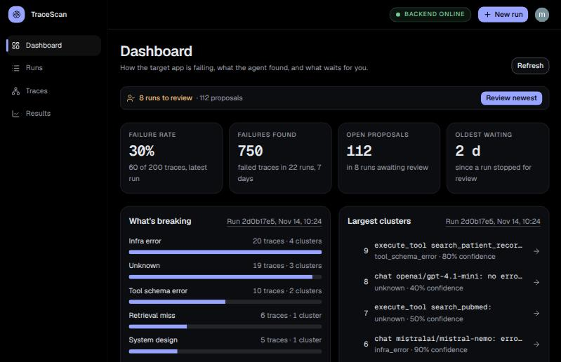

---

## At a glance

| | |
| --- | --- |
| **The app it watches** | Medas, a clinician-facing RAG assistant (my own project, traced from its own repo) |
| **Where it stands** | MVP gate passed on 2026-11-14. Stretch work under way: real GitHub issues, the memory stores and the review UI are built; the reproducer is not |
| **Seeded day** (52 synthetic traces, 8 faults) | Judge catches **34/34** faulty traces and flags **0/18** harmless ones. Detection **8/8**, purity **34/34**, separation **7/8**, cause accuracy **9/9** (8/9 on the latest re-run) |
| **Medas's own faults** (56 real requests, 6 faults) | Judge catches **18/24**, flags **0/32**. Detection **5/6**, separation **5/6**, but cause accuracy only **2/5** |
| **Control day** (52 harmless traces) | **0** traces flagged, **0** false alarms |
| **Cost per run** | about **$0.18** (trace judge plus diagnoser) |

### Contents

1. [Scope](#1-scope)
2. [How Medas is traced](#2-how-medas-is-traced)
3. [How fault injection works](#3-how-fault-injection-works)
4. [System architecture](#4-system-architecture)
5. [Components](#5-components)
6. [The agent](#6-the-agent)
7. [Embeddings, clustering and memory](#7-embeddings-clustering-and-memory)
8. [Guardrails, retries and budgets](#8-guardrails-retries-and-budgets)
9. [Human review](#9-human-review)
10. [Eval metrics](#10-eval-metrics)
11. [The eval journey](#11-the-eval-journey)
12. [The json-render console](#12-the-json-render-console)
13. [Limits and next steps](#13-limits-and-next-steps)

---

## 1. Scope

> *What problem does TraceScan solve, and where does it stop?*

**The problem.** LLM apps fail in quiet ways: a tool times out, a search finds nothing and the model answers anyway, a prompt overflows the context, a provider returns a 503. Each failure leaves a trace, but nobody reads hundreds of traces a day. The failures that matter are mixed in with harmless errors (a retried rate limit, an expected "not found"), and one bug shows up as forty separate failures.

**The user.** The engineer on call for an LLM app. The first one is me, as the builder of Medas. End users of the app (clinicians) are not users of TraceScan.

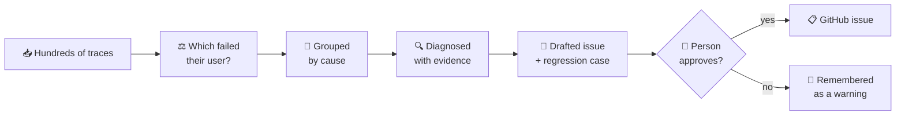

| In scope (built) | Stretch (built) | Out of scope |
| --- | --- | --- |
| Tracing Medas with our own stack | Real GitHub issues in a private repo | Any write without a human approval |
| A triage loop: judge, cluster, diagnose, draft | Known-issues memory and healthy-span comparison | Fixing the bugs automatically |
| A human review before any write | The web app: dashboard, run page, 3D cluster map, trace browser | Apps other than Medas (the design allows them, nothing else is wired) |
| Dry-run output (local files) | Resumable runs, a rate limit, Clerk sign-in | A third-party observability platform (Langfuse was considered and dropped) |
| The fault-injection eval | The json-render agent console | |

**Not built yet:** the reproducer (replaying a cluster's inputs to confirm the cause), so every diagnosis is marked `unverified`, and the second half of the known-issues memory (commenting on an existing issue instead of drafting a new one).

**One constraint shapes everything: clinical data.** Medas traces could touch patient data. So names, statuses, error types and counts travel through the pipeline, while prompts, answers and patient records never do. Medas puts none of them on a span to begin with.

---

## 2. How Medas is traced

> *How do traces get from Medas into TraceScan, and what is in them?*

Medas is instrumented in its own repository ([Nelev/medas](https://github.com/Nelev/medas), `medas-api/tracing/`). A LangChain callback handler builds **one OpenTelemetry trace per agent run** and exports it over OTLP/HTTP to TraceScan's collector.

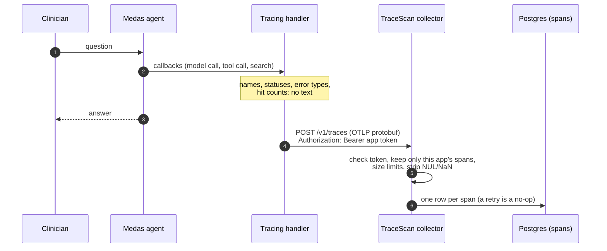

### What a trace looks like

Span names follow the [OpenTelemetry GenAI conventions](https://opentelemetry.io/docs/specs/semconv/gen-ai/):

| Span name | What it is | Useful attributes |
| --- | --- | --- |
| `invoke_agent medas` | The whole request (the root) | `service.version`, `medas.reply.format` |
| `chat <model>` | One call to the language model | the model, token counts |
| `execute_tool <tool>` | One tool call, such as a PubMed search | `gen_ai.tool.name`, `error.type` |
| `retrieval record_chunks` | A search of the patient record | `retrieval.hits` |

An example. A clinician asks a question, PubMed doesn't answer in time, and the model answers without it:

```text
invoke_agent medas                         ok      12.6 s
├── chat openai/gpt-4.1-mini               ok       1.1 s
├── execute_tool search_pubmed             error   10.2 s   httpx.ReadTimeout
└── chat openai/gpt-4.1-mini               ok       1.3 s
```

**The root's status is `ok`.** As far as status codes go the request succeeded, yet the clinician got an answer with no literature behind it. This is why TraceScan uses an LLM judge, not status codes.

### Three details that matter later

- **A tool that reports a failure without raising** (it tells the model "source unavailable") becomes a span with status `error` and `error.type` `ToolReportedError`. Otherwise the failure would be invisible.
- **Two safe signals for failures with no error:** the reply's shape on the root (`medas.reply.format`, such as `malformed`) and a failed lookup's own reason (`source timed out`). They were added after the first eval on Medas showed the judge could not see these faults.
- **What the collector refuses:** no token or an unknown one (`401`), another content type (`415`), an export over 4 MiB or 2,000 spans (`413`), and spans that start more than 5 minutes in the future (dropped).

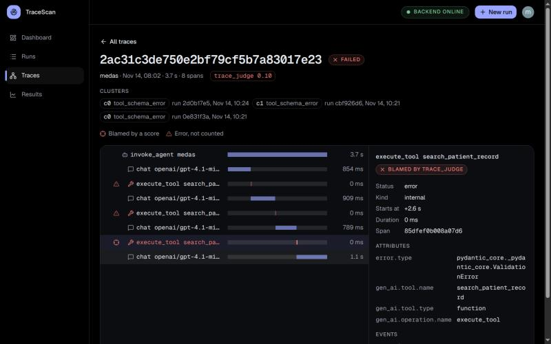

<details>
<summary>Details: the stored span</summary>

```json
{
  "trace_id": "4bf92f3577b34da6a3ce929d0e0e4736",
  "span_id": "00f067aa0ba902b7",
  "parent_span_id": "a3ce929d0e0e4736",
  "name": "execute_tool search_pubmed",
  "status": "error",
  "status_message": "search_pubmed timed out after 10.2s",
  "attributes": {
    "gen_ai.operation.name": "execute_tool",
    "gen_ai.tool.name": "search_pubmed",
    "error.type": "httpx.ReadTimeout"
  }
}
```

There is no `traces` table: a trace is the spans that share a `trace_id`. The resource's `service.version` and schema URL are kept on every span, so the diagnoser only compares a failing step with healthy calls of the same app version. Code: `backend/api/traces.py`.
</details>

---

## 3. How fault injection works

> *How can we score a triage system when nobody knows the right answer for real traffic?*

By **injecting faults whose cause we know**, mixed with healthy traffic, and scoring what TraceScan finds against an answer key. There are two setups, plus a control.

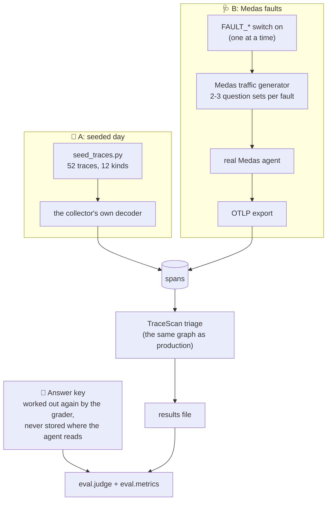

### Setup A: the seeded day

`scripts/seed_traces.py` writes one day of synthetic Medas traffic with the OpenTelemetry SDK, through the collector's own decoder. Same span names and attributes as real Medas, no text at all.

| Kind | Traces | What it is |
| --- | --- | --- |
| **Plain faults** | 22 | PubMed timeout (6), bad tool arguments (5), provider down (5, with two faces: a 5xx or a timeout), context overflow (5), record store down (1, the rare one) |
| **Hard cases** | 12 | a **look-alike** timeout set too tight (3), **two errors** where the first isn't the cause (2), a failure at the **root span only** (3), a search that **silently** finds nothing (4) |
| **Not faults** | 18 | healthy requests (12), a retried rate limit (3), an expected "not found" (3) |

**Keeping the answer secret.** The kind of each trace is worked out again from the day's end time (`seed_traces.kinds(end)`) and never stored, so nothing the agent reads gives it away.

### Setup B: Medas's own faults

The seeded day is something I wrote to look like Medas. So the second setup asks the same question of **Medas itself**: switch on a real bug in the real agent, send real questions, and see what TraceScan finds.

| Fault (`FAULT_*` switch) | What breaks | What the trace shows | The cause a diagnosis must name |
| --- | --- | --- | --- |
| Empty retrieval | The record search drops every passage for medication searches | A search with 0 hits, no error | A filter that empties one category |
| Broken tool schema | A tool argument is renamed | A validation error on every call | The argument no longer matches the schema |
| Truncated prompt | The system prompt is cut before its Output section | A malformed reply, no error | The prompt lost its output format |
| Small context | Too few tokens to keep a search result | The same search round after round | The context budget is too small |
| Weak model | Another model, which skips its tools | One model call and nothing else | The model was swapped |
| Upstream timeout | Half the health-source calls time out | A lookup with `source timed out` | The health sources time out |

**How a window is built** (`eval/medas_run.py`):

1. One child process per question set, each running Medas's traffic generator with **only that switch on**. Questions vary in wording, spelling and language.
2. Every normal and edge-case question again with **no switch on**, as controls.
3. Each trace is matched to the send that produced it. A trace counts as faulty **only if the fault actually fired on it**, read off its stored spans by the grader (a 50% timeout share can spare a request).

That gives 56 requests: 24 faulty and 32 healthy. The traffic was sent once. Every later TraceScan change was measured with `--retriage` on **the same stored window**, so only TraceScan changed between results.

### The control day

`eval.run --control` seeds 52 harmless traces only (healthy, retried, not-found). Anything found there is a false alarm.

---

## 4. System architecture

> *What are the moving parts, and where are the trust boundaries?*

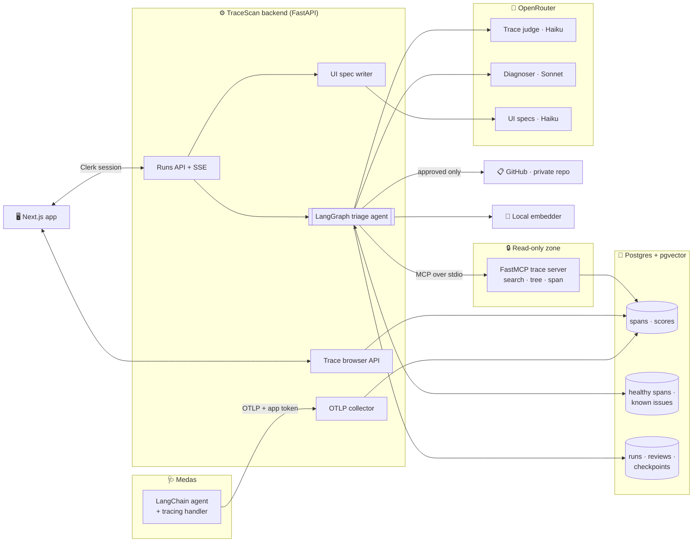

**Four boundaries to look at:**

| Boundary | Rule | How it is enforced |
| --- | --- | --- |
| **Agent ↔ database** | The agent never touches the database. It reads traces only through the MCP server | `test_boundaries.py` fails if `agent/` imports a DB driver, SQLAlchemy or `db` |
| **Trace reads** | Read-only, sanitized, budgeted | Read-only transactions, an attribute allowlist (others read `[redacted]`), 500 tool calls per run, an audit log of argument hashes |
| **Writes to the outside** | Only after a person approves | Only `apply_actions` writes, and it runs after `human_review`. GitHub only in a **private** repo (checked at startup) |
| **Identity** | Only from a verified token | Clerk session token on every route but `/health` and the collector (which has its own app token). A test walks every route |

**Why build our own tracing stack** instead of Langfuse? It keeps clinical traces in one database I control, and it lets me decide exactly what the agent can read. The cost was time, which the PRD flagged as a risk.

---

## 5. Components

> *What does each part do, and what must it never do?*

| Component | Code | Its job | Never |
| --- | --- | --- | --- |
| **Medas tracing** | `Nelev/medas` `medas-api/tracing/` | One trace per agent run, OTLP export | Put prompt, answer or record text on a span |
| **Collector** | `api/traces.py` | Decode OTLP, keep the sending app's spans, store each once | Accept spans without an app token |
| **Trace store** | `trace_store/postgres_reader.py` | Read spans as summaries and trees | Write anything |
| **MCP trace server** | `trace_store/mcp_server.py`, `guard.py` | The agent's only view of traces: `search_traces`, `get_trace_tree`, `get_span` | Serve another app, take a malformed id, log raw arguments |
| **Triage agent** | `agent/` | The LangGraph pipeline: judge, cluster, diagnose, draft, wait, apply | Import a DB driver, write before review |
| **Runs module** | `runs/` | A run's lifecycle: start, stream, status, review lock, resume, recovery after a crash | Hand callers raw graph state |
| **Memory stores** | `runs/healthy.py`, `runs/known_issues.py` | pgvector: healthy calls to compare with, past decisions to learn from | Send trace text out to be embedded |
| **API** | `api/runs.py`, `api/trace_browser.py` | HTTP and SSE over the runs module and the trace store | Let a request set `dry_run` or the user's name |
| **Auth** | `auth/` | Verify Clerk session tokens | Trust a header for identity |
| **Frontend** | `frontend/` | Dashboard, runs, live run page, cluster map, findings and review, trace browser, results, console | Log the issue text (it may hold clinical prose) |
| **Eval** | `eval/`, `scripts/seed_traces.py` | Seed or send traffic, triage it, grade it | Store the answer key where the agent can read it |

The run page is where most components meet: the stepper shows the graph's progress, the Map tab the clustering, and the Findings tab the diagnoses and the review.

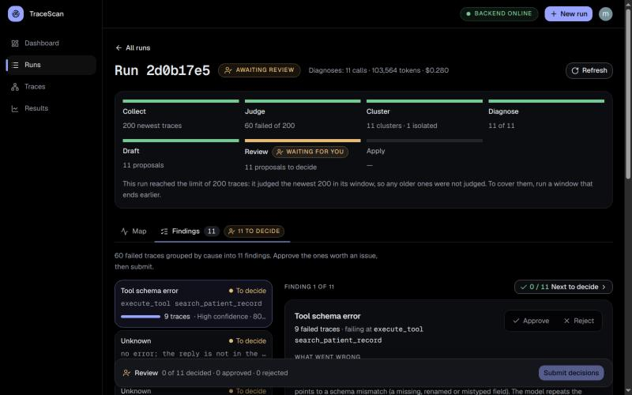

---

## 6. The agent

> *How does a run go from a time window to proposals?*

The agent is **one LangGraph `StateGraph`**. Parallel work fans out with `Send`, and the run pauses for the human with `interrupt()`.

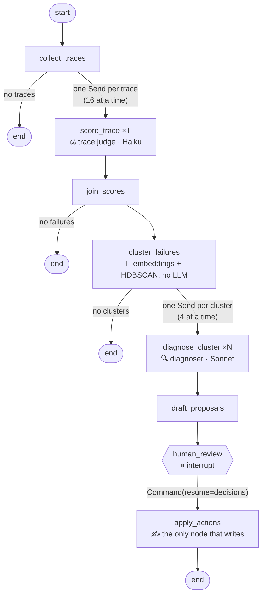

### The nodes

| # | Node | LLM? | What it decides |
| --- | --- | --- | --- |
| 1 | `collect_traces` | – | Takes every trace in the window, newest first, **up to 200** |
| 2 | `score_trace` ×T | Haiku | **Did this request fail its user?** A score 0 to 1 (≤ 0.5 is failed), the blamed span, an attribution. A clean trace may name up to 3 healthy spans |
| 3 | `join_scores` | – | Collects the failed traces, each labelled with its blamed step and error type |
| 4 | `cluster_failures` | – | **Which failures share a cause?** Embeds a short failure text locally, clusters it, and projects it to 3D for the map |
| 5 | `diagnose_cluster` ×N | Sonnet | **Why?** A category, root cause, fix, confidence and cited spans, from 3 exemplar trees |
| 6 | `draft_proposals` | – | One issue and regression case per cluster. An undiagnosed cluster gets a stub, never dropped |
| 7 | `human_review` | – | Pauses. Resumes with one decision per proposal |
| 8 | `apply_actions` | – | Writes approved issues and regression cases, and remembers every decision |

Parallel branches get small private inputs (a `TraceTask`, a `ClusterTask`), not the whole state, and their outputs are merged with append reducers.

### The trace judge: the lessons in its prompt

Each rule came from an eval failure (see [the journey](#11-the-eval-journey)):

- A model that answers after a failed tool call **has not recovered**. Recovery means the same step redone successfully.
- A lookup that says "not found", told to the user, is **the app working as designed**.
- A search with 0 hits **is a failure**, even with no error span.
- An unsure judge scores **0.6, never 0.5**, so doubt is not counted as failure.
- One failed lookup among several **fails the request**. The same tool asked for in 4 or more rounds is a loop.

If the judge blames a span that isn't in the tree, it is asked once more; if it is still wrong, the code blames the deepest error span.

### Clustering: code, not LLM calls

Each failure becomes one short text, embedded **on the machine**, then grouped by HDBSCAN and a second pass by failing step and error type. No model call is involved. [Section 7](#7-embeddings-clustering-and-memory) explains it step by step.

### The diagnoser: what it sees

- The failure taxonomy as its system prompt (`retrieval_miss`, `tool_schema_error`, `context_overflow`, `prompt_regression`, `model_quality`, `infra_error`, MAST's `system_design`, `inter_agent_misalignment`, `task_verification`, and `unknown`).
- The span trees of the cluster's 3 newest traces, sanitized.
- Up to 3 **healthy twins**: the same step, working, on the same app version and schema. They answer "what does normal look like?"
- Up to 3 **known issues**: past decisions on a similar failing step. Approved ones read as confirmed causes, rejected ones as warnings.

Twins and known issues are context only: **they cannot be cited as evidence.** How both are picked and put in the prompt is in [section 7.4](#74-how-the-diagnoser-gets-them).

<details>
<summary>Details: a diagnosis</summary>

```json
{
  "category": "infra_error",
  "root_cause": "search_pubmed has a 10 s timeout and PubMed regularly exceeds it; the tool reports the timeout to the model, which answers without sources.",
  "suggested_fix": "Retry once with backoff, and tell the user when literature search is unavailable.",
  "confidence": 0.82,
  "evidence": [{ "trace_id": "4bf9…", "span_id": "00f0…", "note": "ReadTimeout after 10.2 s" }]
}
```

The code adds `evidence_check` (`valid`, `corrected` or `unsupported`) and how many healthy twins and memories the prompt showed. The model never fills these.
</details>

---

## 7. Embeddings, clustering and memory

> *How are failures grouped without an LLM, and what does the diagnoser get to compare a failure with?*

TraceScan uses **one local embedding model for three jobs**. Every text it embeds is built by code from span names, statuses, error types and bucketed numbers, so no prompt, answer or record text is ever embedded, and nothing is sent out to be embedded.

| Job | What is embedded | Where the vectors live | Written | Read |
| --- | --- | --- | --- | --- |
| **Clustering** the run's failures | one *failure text* per failed trace | in memory, for this run only | – | by `cluster_failures`, at once |
| **Healthy spans** | one *step text* per healthy step the judge picked | pgvector, collection `healthy_spans` | after every run that ends or pauses at the review | by the diagnoser, as *healthy twins* |
| **Known issues** (approvals and rejections) | the failing step's text of each decided finding | pgvector, collection `known_issues` | by `apply_actions`, after the review | by the diagnoser, as *known issues* |

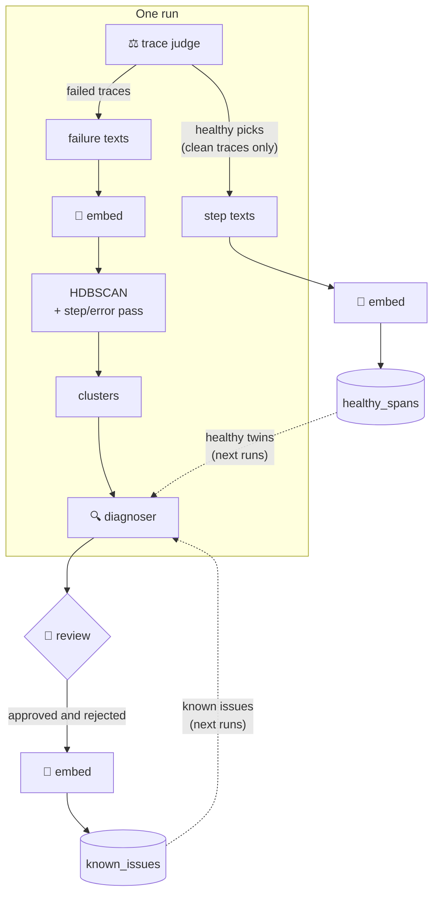

### The embedding model

| | |
| --- | --- |
| **Model** | `BAAI/bge-small-en-v1.5`, 384 dimensions |
| **Runtime** | [fastembed](https://github.com/qdrant/fastembed): ONNX on the CPU, no GPU and no API |
| **Loading** | on the first call, once per process (behind a lock, since two runs can arrive together), cached under `FASTEMBED_CACHE_PATH` |
| **Calls** | one batch per job; it is CPU-bound, so it runs off the event loop (`asyncio.to_thread`) |
| **For pgvector** | wrapped as LangChain `Embeddings` (`LocalEmbeddings`), so langchain-postgres's `PGVector` embeds with it too |
| **Versioned** | every stored text carries `CHUNK_TEMPLATE_VERSION`: a vector is only compared with one built from the same template |

Code: `agent/embeddings.py`, `agent/chunks.py`.

### 7.1 Clustering failures with HDBSCAN

**What is embedded.** Each failed trace becomes one line: the step the judge blamed, its error message, and the signature.

```text
execute_tool search_pubmed: search_pubmed timed out after very slow (>5 s) | <signature>
```

Three rules keep this text about the *cause*, not about the values of one request:

- **Seconds become words first** (`fast`, `normal`, `slow`, `very slow`). A 1 s timeout and a 10 s timeout are different faults (experiment 6 found them merged).
- **Then every digit is masked** to `#`, so ids, counts and sizes don't split one cause into many clusters.
- **A failure with no error** gets its symptom in fixed words in place of the message (`no error; a search returned nothing`, `no error; the same tool asked for round after round`, `no error; the reply is not in the shape the app asks for`), so different silent failures don't merge.

**Why HDBSCAN.** It needs no number of clusters up front, it finds groups of any shape by density, and it leaves outliers as *noise* instead of forcing them into a group. That suits failures: a run may hold one bug or ten, and a one-off failure should stay alone.

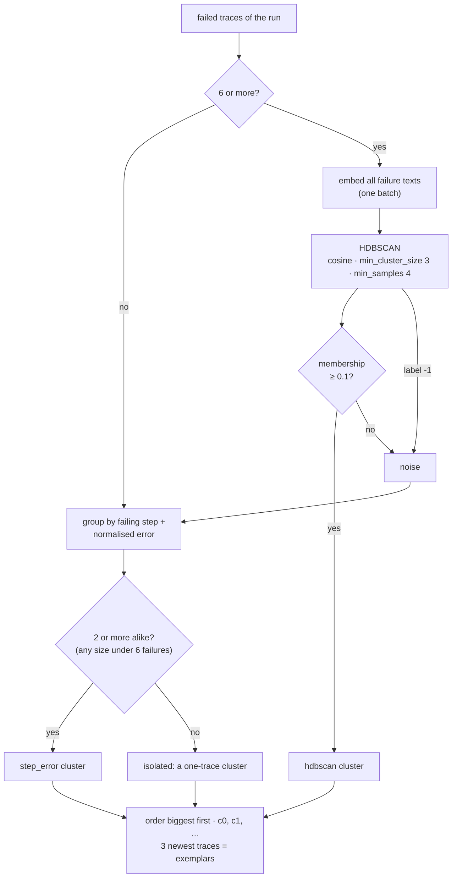

1. **Embed.** All failure texts of the run in one batch.
2. **HDBSCAN** (scikit-learn) on the vectors, with **cosine distance**, `min_cluster_size` 3 and `min_samples` 4. Each trace gets a label (-1 for noise) and a membership strength.
3. **Weak members become noise.** HDBSCAN can attach a lone outlier to its nearest group with a membership of 0.0. Anything under **0.1** is treated as noise, so the rare record-store outage is diagnosed alone instead of hiding in a bigger cluster.
4. **The second pass.** Noise is regrouped by failing step and *normalised* error (lower case, quoted values read `'x'`, digits `#`). Two or more alike make a `step_error` cluster: the same step failing the same way is one issue, however few times it happened. This pass also catches what HDBSCAN cannot see: when one fault causes most of a run's failures, HDBSCAN can label the whole group noise.
5. **The rest are `isolated`**: one-trace clusters, so a rare failure still gets a diagnosis. At most 10 are diagnosed per run; the others still get a proposal, marked undiagnosed.
6. **Small runs** (under 6 failures) skip the embedding and HDBSCAN: every step-and-error group counts, even a group of one, since with so little data nothing can be called noise.
7. **Naming.** Clusters are ordered biggest first (`c0`, `c1`, …). A cluster's signature is its most common step and normalised error. Its exemplars, what the diagnoser reads, are its **3 newest traces**.

**The cluster map.** The same vectors are projected to 3D for the run page: identical vectors become one point, PCA is always tried and seeded t-SNE from 30 points, and the map keeps whichever keeps each point's 5 nearest neighbours better (its *trustworthiness*, shown as "fidelity").

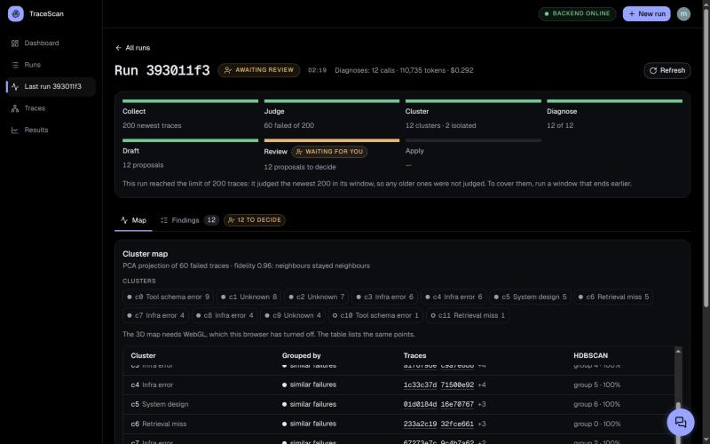

*A run over Medas's traces from the last week: 200 judged, 60 failed, 12 clusters. With WebGL the Map tab draws the clusters in 3D; here PCA won with a fidelity of 0.96. This capture is its table view, which lists the same points.*

Code: `agent/clustering.py`, `agent/nodes/cluster_failures.py`.

### 7.2 Healthy spans: how they are sampled and stored

A failing step is easier to explain next to the same step working. So TraceScan keeps a library of **healthy calls**, collected as a side effect of judging.

**Sampled by the trace judge, filtered by code.** When the judge scores a trace, it may also name up to 3 spans that worked (`healthy_span_ids`). The code keeps a pick only when all of these hold:

| Check | Why |
| --- | --- |
| The trace scored **0.9 or more** | a borderline "fine" is not an example of a step working |
| The trace is **clean**: no error span, no retrieval with 0 hits | a retried or reported failure, or an answer with no records behind it, is not a clean example. No exception is no proof of a right answer, so these proxies are strict |
| The span **is in the tree** and is **not the root** | the root is the whole request, not a step |
| **At most 3**, each once | keeps one trace from flooding the library |

A bad pick is dropped, never asked about again. So the library is not a random sample: it is the steps of clearly good requests, chosen by the judge and checked by code.

**What is embedded: the step text.** Six labelled lines, the same template for healthy and failing steps, so a failing step's text is the search query:

```text
step: execute_tool search_pubmed
outcome: ok
previous: chat openai/gpt-4.1-mini
next: chat openai/gpt-4.1-mini
inside: invoke_agent medas
latency: slow (2-5 s)
```

Only names, the status, the error type and bucketed numbers go in (`hits: none`, `some (1-10)`, `many (>10)`; latency as a word). No status message and no other attribute value, since those can hold clinical text.

**The step key.** Each pick is stored with what a twin must share with a failing step: the **span name**, its `gen_ai.operation.name`, the **app version** (`service.version`) and the **telemetry schema** URL. A field the trace didn't send is stored as `unknown`, and matches only calls that didn't send it either.

**Stored without review.** After every run that ends or pauses at the review, the picks are embedded and saved to pgvector (collection `healthy_spans`), one document per pick, with its id `<trace>:<span>:v<template version>`, so judging the same window again replaces rows instead of adding them. This is one of only two writes made without a person's approval, which is acceptable because it holds no clinical text and never leaves TraceScan's database. A failed save is logged by type and doesn't fail the run.

Code: `agent/judge.py` (`clean`, `healthy_picks`), `agent/chunks.py` (`step_text`, `step_key`), `runs/healthy.py`.

### 7.3 Approvals and rejections: the known-issues memory

Every finding a reviewer decides on teaches the next runs something. An approved diagnosis is a **confirmed cause**; a rejected one is a **warning** that this explanation was judged wrong.

**Written once a person decides.** `apply_actions`, after the review, stores one memory per decided, diagnosed finding whose trace judge blamed a span, **approved or rejected**. That is why a review that rejects everything still goes through `apply_actions`.

**What is embedded.** The failing step's *failure text*: its step text, plus a `symptom:` line in the judge's fixed words when the step failed silently. Without that line, two different silent faults at the same step would read the same and match each other. The diagnoser keeps this text on the diagnosis (`failing_step`), because `apply_actions` reads no traces.

**What comes back with a match** (metadata): the verdict (`approved` or `rejected`), the category, the root cause, the suggested fix, the signature, and the run and cluster it came from. A new cluster knows its symptom but not its cause; the memory hands back the cause.

**Replaced, not duplicated.** The id is `<app>:<run>:<cluster>:v<template version>`, so a review resubmitted after an error replaces its rows.

**A rejected diagnosis is a warning only.** It is shown to the diagnoser as "judged wrong", and it is never used to match, merge or suppress an issue.

Code: `agent/memory.py`, `runs/known_issues.py`, `agent/nodes/apply_actions.py`.

### 7.4 How the diagnoser gets them

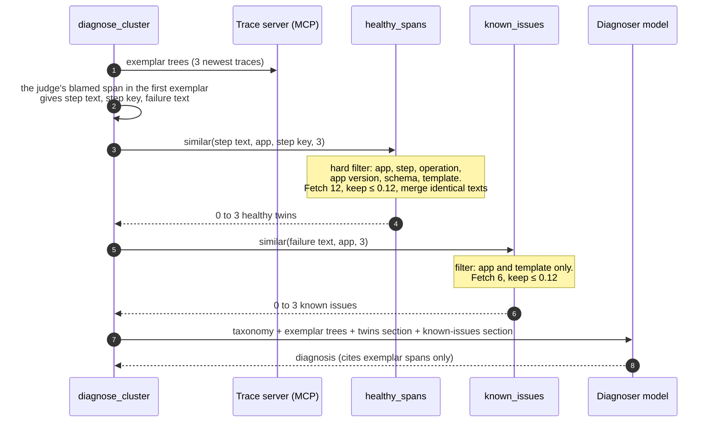

**1. The query.** The diagnoser takes the span the trace judge blamed in the first exemplar that has one, and builds its step text (for twins), its step key, and its failure text (for known issues). No blamed span means neither lookup runs.

**2. Healthy twins.** One pgvector search, with the step key as a **hard metadata filter in the same query** as the vector search: same app, step, operation, app version, schema and template version. It fetches 12 candidates for 3 twins, keeps those within cosine distance **0.12**, and merges identical texts into one twin that says how many calls share it.

> **Why the filters do the real work.** bge-small bunches its distances: on the seeded day, healthy calls of the *same* step sat 0.044 to 0.097 from a failure, and the nearest texts of *other* steps 0.053 to 0.11. A distance alone can't tell them apart, so the hard filters decide relevance and 0.12 is only a safety net. The diagnoser may get fewer than 3 twins, or none.

**3. Known issues.** One pgvector search filtered on the **app and template version only**, not the step key: the same cause can fail at a neighbouring step, or after an app upgrade. It fetches 6 candidates for 3, and keeps those within **0.12**, nearest first.

**4. Into the prompt.** Each lookup that finds something adds one section after the exemplar trees, in the prompt's own words:

```text
The failing step of exemplar <trace>, span <span>:
<its step text>
Healthy calls of the same step, on the same app version, from requests that went fine,
nearest first. Compare them with the failure to find what differs.
They are not evidence: do not cite them.
<twin 1>
---
<twin 2>
(seen in 4 healthy calls)
```

```text
Past diagnoses a reviewer decided on, for failures whose failing step reads like this one,
nearest first. A confirmed cause may apply here if this cluster's failure is the same kind
and its evidence agrees. A rejected cause was judged wrong: do not propose it again unless
the evidence clearly supports it. They are not evidence: do not cite them.
[CONFIRMED by a reviewer] failure: <signature>
category: <category>
cause: <root cause>
fix: <suggested fix>
---
[REJECTED by a reviewer] failure: …
```

**5. Guarded and recorded.** Both lookups are best effort: a failure is logged by exception type and the prompt goes on without that section. The evidence check still accepts only spans of the exemplar trees, so a twin or a memory can never be cited. The stored diagnosis records how many twins (`healthy_twins`) and memories (`memories`) its prompt showed, so a run tells whether the context was there.

| | Healthy twins | Known issues |
| --- | --- | --- |
| **Answers** | "What does this step look like when it works?" | "Has a person already confirmed or rejected a cause for a failure like this?" |
| **Source** | the trace judge's picks from clean traces scored ≥ 0.9 | reviewers' decisions, approved and rejected |
| **Written** | after every run, without review | by `apply_actions`, after the review |
| **Embedded text** | step text | failure text (step text + symptom) |
| **Filter** | app, step, operation, app version, schema, template | app, template |
| **Kept** | ≤ 3, distance ≤ 0.12, identical texts merged | ≤ 3, distance ≤ 0.12 |
| **In the prompt as** | comparison, not citable | confirmed causes or warnings, not citable |

---

## 8. Guardrails, retries and budgets

> *What stops the agent from doing harm, spending too much, or making things up?*

### Every model call goes through one path

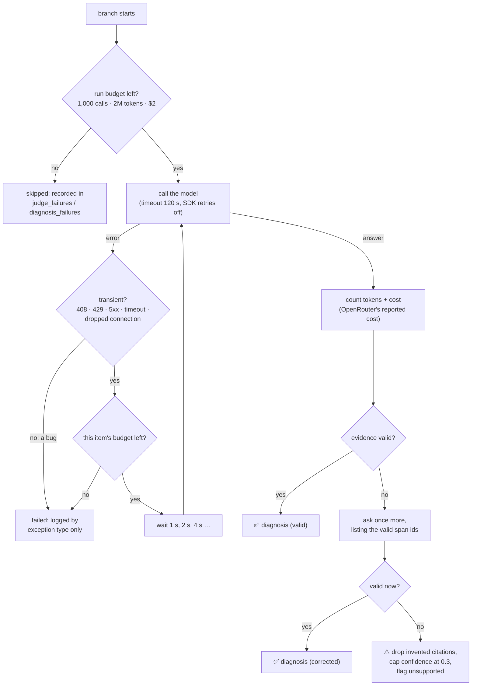

The evidence check (the lower half) applies to the diagnoser; the trace judge has the same budget and retry path, with a blame re-ask instead.

**Why the retry loop sits inside the node** and not in the graph: a run is durable only once it waits for review, so checkpointing retry state would buy nothing. The SDK's own retries are off so that every attempt is counted against the budget. A good first answer is never asked for again: retries are per call, not per node.

### Budgets

| Scope | Calls | Tokens | Cost | When it runs out |
| --- | --- | --- | --- | --- |
| **One trace** (judge) | 3 | 20k | $0.05 | That trace is recorded as a judge failure |
| **One cluster** (diagnoser) | 3 | 100k | $0.50 | The cluster gets an undiagnosed stub proposal |
| **One run** | 1,000 | 2M | **$2** | New branches are skipped (checked per branch, so a run can overrun by the branches already running) |
| **MCP tool calls** | 500 per run | – | – | The trace server refuses further calls |
| **UI specs** (console) | 40 per run, 15 s each | – | – | Messages get no spec and are not drawn |
| **Runs per user** | 10 per hour | – | – | `429` with `Retry-After`, nothing opened |
| **Traces per run** | 200 judged | – | – | Older traces in the window are not judged, and the page says so |

### Safety guardrails

| Guardrail | Why |
| --- | --- |
| **Read-only trace access** through one MCP server, enforced by a test | The agent can't change or leak the trace store |
| **Typed ids** (`TraceId` pattern) and an **app allowlist** | A prompt-injected id or app name is refused by pydantic |
| **Sanitized trees**: attributes outside an allowlist read `[redacted]`, long text truncated | Clinical text doesn't reach the models |
| **Cited spans checked** against the trees the model saw | No invented evidence reaches a reviewer |
| **Only `apply_actions` writes**, after a human decision | A rejected proposal never reaches GitHub |
| **`dry_run` on by default**, set only by the server | No request can turn on real writes |
| **Private repo only**, checked at startup | The issue body is the model's prose, possibly clinical |
| **Logs carry exception types**, never messages, arguments or results | Clinical text never lands in logs |
| **Rejected diagnoses are warnings only** | They never match or suppress a future issue |

The two writes made without review are the judge's scores and the healthy-span store. Both hold only ids, scores, names and error types, and stay in TraceScan's database.

---

## 9. Human review

> *How does a person decide, and what happens after?*

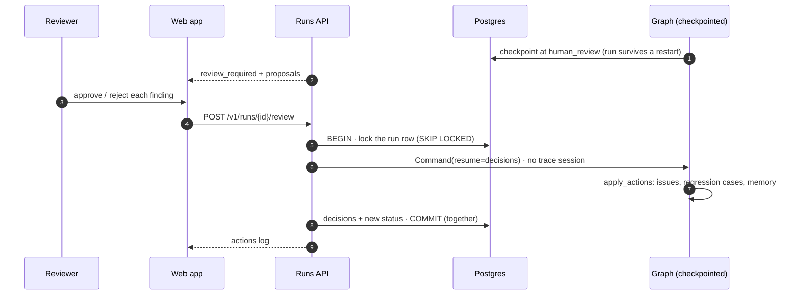

- **One review at a time.** A second review of the same run skips the locked row and gets `409`, in any process.
- **All or nothing.** The decisions and the new status commit together, or roll back together if the apply fails.
- **Resumable.** A run that failed or was stopped resumes from its last checkpoint, and only the unfinished steps run again.
- **Idempotent on GitHub.** Each issue carries a hidden run and cluster marker, so a resubmitted review opens only the missing issues.

Each finding reads top to bottom the way a reviewer asks: what kind of failure, where it fails, what went wrong, how to fix it, and how sure the agent is.

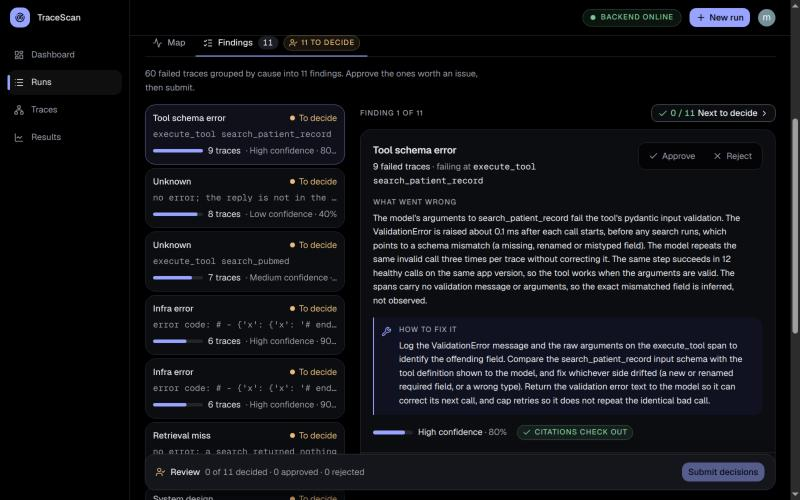

"See the evidence" opens the cited spans, numbered, with the trace they come from. Cited spans are starred and the judge's blamed span is marked.

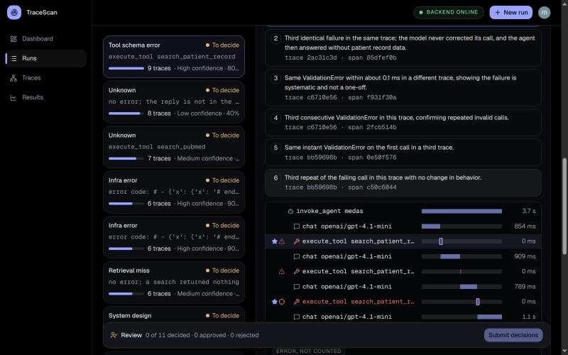

---

## 10. Eval metrics

> *What exactly is measured, and why each number?*

Each cluster takes the fault most of its traces belong to (its **majority kind**). Seeded kinds that share an injected cause count as one fault (since experiment 8). Ratios are shown as hits/total, so a reader sees how small the numbers are.

### The trace judge

| Metric | Question | Counted over | Why it matters |
| --- | --- | --- | --- |
| **Judge recall** | Did the judge call each faulty trace failed? | faulty traces | A trace missed here is lost for good |
| **Judge false positives** | Did it flag a harmless trace? | harmless traces | Every false flag can become a bogus issue |
| **Judge blame** | Did it blame the step the fault starts in? | faulty traces caught | The blamed step drives clustering |

### Clustering

| Metric | Question | Counted over | Why it matters |
| --- | --- | --- | --- |
| **Detection** | Did each fault get a cluster where it is the majority, and a diagnosis? | faults | The headline: was the fault found at all? |
| **Purity** | What share of clustered traces sit in a cluster of their own fault? | clustered faulty traces | Mixed clusters produce muddled diagnoses |
| **Separation** | Did each fault land alone in exactly one cluster? | faults | One bug, one issue: no merges, no splits |
| **Rare recall** | Did the one-trace fault get its own diagnosis? | rare faults | Rare bugs are easy to absorb into a big cluster |
| **Trace recall** | How many faulty traces reached a cluster? | faulty traces | Catches losses between the judge and clustering |

### Diagnosis

| Metric | Question | Counted over | Why it matters |
| --- | --- | --- | --- |
| **Category accuracy** | Is the category right? | diagnoses of a fault | Triage routing |
| **Cause accuracy** | Does the root cause name the **injected cause** (grader score 2 of 2)? | diagnoses of a fault | Graded on the cause, not the visible symptom |
| **Evidence valid** | Do the cited spans exist in the cluster? | diagnoses | No hallucinated evidence |
| **Evidence relevant** | Do they include the span the fault failed in? | diagnoses | The evidence points at the bug |
| **False alarms** | How many clusters hold no fault? | clusters | The reviewer's wasted time |

### Cost

`calls`, `tokens`, `cost_usd` (judge plus diagnoser), `judge_cost_usd` and `seconds` per run.

**How cause accuracy is graded.** A grader from **another vendor** (`openai/gpt-6.1-sol`, so it doesn't share the diagnoser's blind spots) sees a rubric, the true cause, the visible symptom and the diagnosis's root-cause text only. It reasons, then scores 0, 1 or 2. A diagnosis of a cluster with no fault is not graded: it counts as a false alarm.

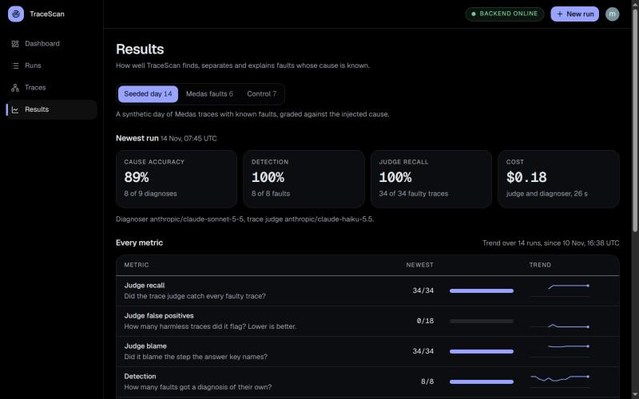

<details>
<summary>Details: commands</summary>

```bash
cd backend
uv run --env-file .env python -m eval.run          # seed a day, triage it → out/eval/<time>.json
uv run --env-file .env python -m eval.medas_run    # or: send Medas's faults, triage the window
uv run --env-file .env python -m eval.judge        # grade the root causes
uv run python -m eval.metrics                      # print the scores
uv run python -m eval.metrics --export             # update the results page
```
</details>

---

## 11. The eval journey

> *What did the eval teach, and how did the system change because of it?*

Fourteen experiments over five days, each changing **one thing** and re-running on the same traces. The full log is [eval-notes.md](eval-notes.md). The chart is drawn from `frontend/data/eval-results.json`, scored by cause throughout (8 seeded faults), so its early points can differ slightly from the counts in older notes.

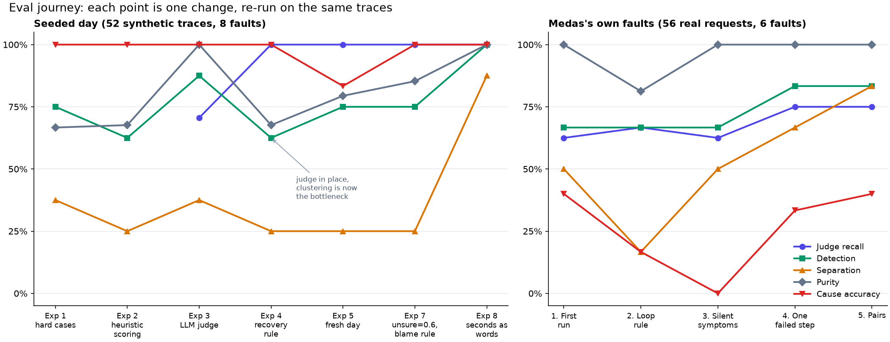

### On the seeded day

| # | Question | What changed | What it showed |
| --- | --- | --- | --- |
| 1 | Does triage work at all? | First runs: plain faults, then hard cases | Plain faults scored 5/5 everywhere, **which proved nothing**. With hard cases, one 17-trace cluster swallowed five kinds, and silent failures were never collected |
| 2 | Do heuristic scores help? | Five code checks per trace | All 34 faults collected, but clusters formed by **step**, not by **cause** |
| 3 | Can an LLM judge replace them? | One Haiku call per trace | Never flagged a harmless trace, but **missed 10 faults**: "the model answered afterwards" read as recovery |
| 4 | Does a stricter recovery rule fix it? | Recovery = the same step redone; judge only what the trace shows | **Recall 34/34**, nothing harmless flagged. Clustering became the bottleneck |
| 5 | Does it hold on an unseen day? | A fresh day and a control day | Yes, but one control trace scored **exactly 0.5**, which counts as failed |
| 6 | Why does clustering merge faults? | Analysis only | Masked digits made look-alike timeouts **identical**; HDBSCAN attached outliers with membership 0.0 |
| 7 | Can the judge stop sitting on 0.5? | Unsure is 0.6, "not found" is fine, blame the error that ended the request | Blame 32 → 34/34, control false alarms 1 → 0 |
| 8 | Can clustering keep faults apart? | Seconds as words, membership threshold 0.1, shared causes count as one fault | **Detection 8/8, purity 34/34, separation 7/8** |

### On Medas's own faults

| Step | What changed | Effect |
| --- | --- | --- |
| 1. First run | The judge as it was | Found what raised an error, **missed everything silent** (15/24) |
| 2. Loop rule | The same step in 4 or more rounds fails the request | One more fault caught, but silent failures merged (separation 1/6) |
| 3. Silent symptoms | Fixed words for failures with no error | Silent failures cluster apart again (separation 3/6) |
| 4. One failed step | One failed lookup fails the request | Recall 18/24, detection 5/6 |
| 5. Pairs | Two identical failures make one cluster | **Separation 5/6**, purity 18/18 |

After each change, the seeded day and the control day were re-run: they did not regress (8/8 detection, 0/52 control flags).

### What the journey taught

1. **Easy evals lie.** The plain faults scored perfectly on day one. Only the hard cases and the real app showed the real weaknesses.
2. **"Did the request fail its user?" needs a judge, not status codes.** But the judge's prompt has to spell out what recovery, "not found" and doubt mean, or it gets them wrong.
3. **Every judge improvement moved the bottleneck to clustering.** And the clustering fixes were all in the *text* being embedded (seconds as words, symptoms in fixed words), not in the algorithm.
4. **TraceScan finds *where* a fault broke more often than *why*.** On Medas, causes are named only when the span says what happened (a validation error, `source timed out`). Better causes need more safe signals from the app, not better prompts.
5. **The eval itself needed fixing twice**: the judge's own accuracy wasn't measured until experiment 5, and a correct merge was scored as a loss until experiment 8.

### Where each Medas fault ends up

| Fault | Judge caught | Finding | Cause graded |
| --- | --- | --- | --- |
| Broken tool schema | 5/5 | one cluster, `tool_schema_error` | **2** |
| Upstream timeout | 2/2 | one cluster, `infra_error` | **2** |
| Small context | 3/3 | one cluster, `system_design` | 1 |
| Empty retrieval | 3/3 | one cluster, `retrieval_miss` | 1 |
| Truncated prompt | 5/5 | one cluster, `unknown` | 0 |
| Weak model | **0/6** | none | – |

**The weak model is invisible on the trace**: one model call and no tool looks exactly like a healthy answer to a simple question. Only the model's name differs, and TraceScan doesn't know which model Medas is meant to use.

---

## 12. The json-render console

> *How does the user follow a run as it happens?*

While a run streams, a chat box in the corner tells the story of the run in plain language. **Its messages aren't hand-built components: for each streamed message, a small model writes the UI**, as a [json-render](https://github.com/vercel-labs/json-render) spec that the frontend checks and draws with the app's design system.

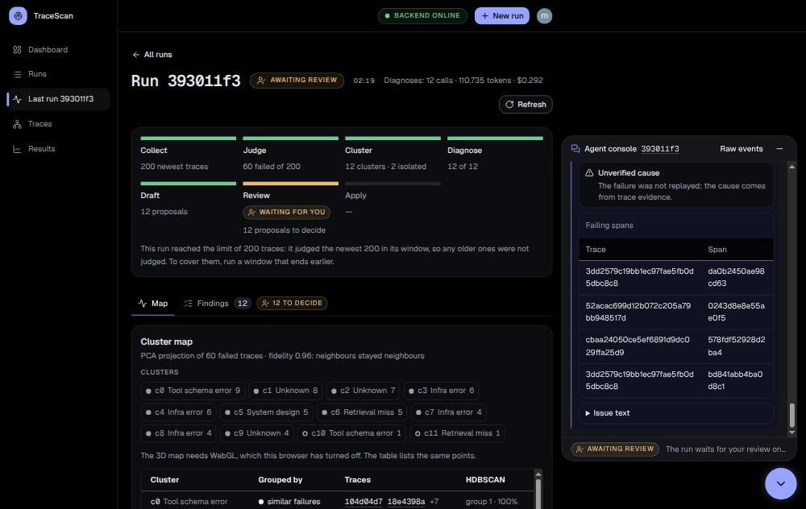

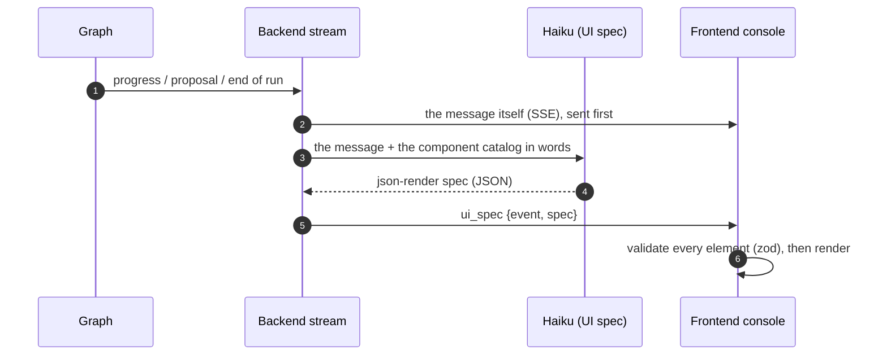

**How it works**

1. **The message goes first.** Each event (`progress`, `proposal`, `review_required` …) is sent to the browser before its UI call, so the call never holds it back.
2. **The model gets the catalog in words.** `npm run export:ui-prompt` writes the frontend's own catalog (33 components, their props and allowed values) to `backend/api/ui_catalog.md`. A test fails when the file is out of date, so the backend and the frontend can't drift apart.
3. **The backend doesn't interpret the spec.** It parses the JSON and passes it on.
4. **The frontend is the gate.** Each element is checked against its component's zod schema. An invalid spec shows one line and logs why (paths and codes, never values).

For example, a `progress` event becomes a badge and a line of text. A `proposal` becomes its title, badges for the cluster and its verification, a warning for an unverified cause, a table of ids, and the issue text in a collapsible.

**Safety.** `Image`, `Avatar` and `Link` are removed from the catalog. They are the only components that take a URL, so a prompt injection copied from a proposal can't make the browser load an outside image carrying clinical text. No actions, no expressions: literal values only.

**Cost and limits.** At most 40 UI calls per run, 15 s each. A slow or failed call means that message isn't drawn. **Raw events** shows the stream exactly as received, for when you want the facts without the layout.

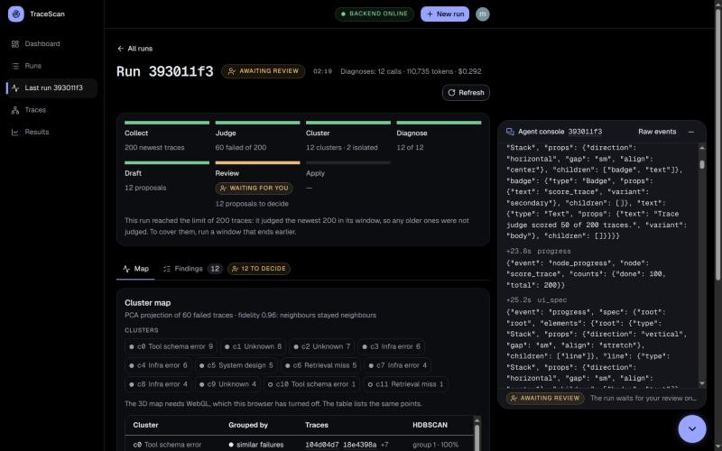

---

## 13. Limits and next steps

### Limits of the evidence

- **One run per configuration.** Model calls are not deterministic: on the seeded day, the same diagnosis was graded 2 one time and 1 the next. Variance isn't measured yet.
- **Partly tuned on what it's scored on.** Judge rules were written after seeing failures on the days they were then scored on. Experiment 5's fresh day and Medas's real faults are the tests on unseen traffic.
- **Small numbers.** 8 faults and 34 faulty traces a seeded day; 6 faults and 24 faulty requests on Medas. One trace moves a ratio by a whole step.
- **One traffic sample on Medas.** Every Medas column triages the same 56 requests.

### Not built yet

- **Reproducer**: diagnoses stay `unverified`.
- **Known issues, second half**: a repeat fault drafts a new issue instead of commenting on the old one; no reject reason is recorded.
- **Weak-model detection**, and causes for silent failures (needs more safe signals from Medas).
- **Ship**: Docker Compose with Medas, a scheduled daily run, the demo video.
- **Smaller**: a dedicated read-only DB role (the session is read-only, the role isn't created), a personal-data scan of issue text before filing.

### Next steps, in order

1. **Repeated runs** (3 per configuration) over fresh Medas traffic, to put error bars on every number.
2. **More safe signals from Medas** (the refused argument's name, the size of what the model was sent), to raise cause accuracy on silent faults.
3. **The reproducer**, so a diagnosis can be marked verified.
4. **Comment on known issues** instead of drafting duplicates.

---

*Sources: [README](../README.md) · [PLAN.md](../PLAN.md) · [eval-notes.md](eval-notes.md) · [eval/eval-review-2026-11-12.md](eval/eval-review-2026-11-12.md) (the earlier eval-only review, 2026-11-12) · [eval-results.xlsx](eval/eval-results.xlsx).*
